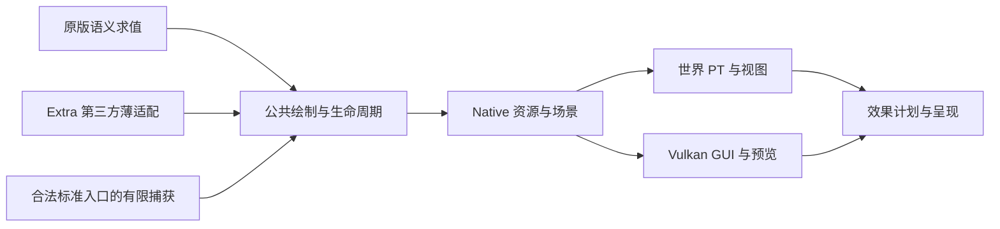

# 原生渲染组件

`native_renderer` 是原 MCVR 的源码组件，在统一仓库中维护渲染、着色器与资源生命周期；迁移前的源码位于历史 MCVR 仓库。

## Java 接入平台与来源

本体内置 `com.radiance.adapter.vanilla` 与 `adapter.neoforge`，负责原版状态、姿态、材质、事件和视图求值；公共入口在 `com.radiance.api.render`。第三方解释、Mixin、版本资格及源数据布局在同级独立仓库 `../Radiance-Extra/`；本体不引用 Extra 类或构建，Extra 不进入本体 JAR。



| 入口 | 正式消费者与数据寿命 |
| --- | --- |
| `RenderPlatform` / `SourceIntegration` | 构造期按实际模组登记参与者；固定 API 版本，不匹配即拒绝；热帧不探测缺席模组 |
| `WorldScene` / `WorldLines` | 原版与 Extra 共用帧、阶段、坐标、查询用途及所有权；未提交的阶段回滚，不改变 PT 语义 |
| `LocalModelBatch` / `PersistentInstances` | 烘焙与刚性部件实际入口；CPU 直接缓冲同步借用到 JNI 返回，纹理所有者覆盖提交；Native 持有模型与实例 |
| `InstanceScene` / `InstanceParameters` | 通用共享网格与参数实例；创建、更新、选择、删除各有入口，Native 同步复制有界 CPU 输入；不暴露 Vulkan 对象 |
| `RenderSpace` / `SectionScene` | 来源拥有共同坐标空间与区段成员；父姿态变化不重写成员内容，区段生命周期进入统一编译、版本和发布流程 |
| `LodScene` | 紧凑 LOD 节点、面和材质投影；版本、代际、完整 cut、near/LOD 交接与退休仍有界 |
| `WorldView` | 不可变矩阵和雾等求值结果；原版相机状态由 Vanilla 适配一次求值，再复制到正式帧输入 |
| `RasterDraws` / `DrawLayers` | GUI、字体、合法离屏与有限程序；即时附件依赖和状态恢复保持，世界不恢复后置光栅 |
| `ScreenEffects` | 已编译程序的有序效果定义；Native 统一验证输入输出并执行，预览合成与 FG 策略另属各自职责 |

渲染线程负责场景提交。注册快照可读；对象移除只登记到线程安全的待退休集合，在后续正式帧向 Native 传递。CPU 缓冲不能在 JNI 返回前修改或释放；返回后可复用。GPU 缓冲由 Native 帧所有者保活，不能因 Java 返回就提前回收。

### 持久实例的实际范围

具有来源对象身份的局部刚性模型跨帧保留模型和实例记录；未变化只传当前视图选择的 64 位身份，变化传由 ABI 定义的 160 字节参数记录及必要绑定。Java 在绑定和参数打包之前检查已接受的实际状态，并复用不可变的局部模型绑定；比较姿态、外观和资源身份，不重新生产全部顶点后 hash。离开某个视图只停止选择，不代表删除；实体／方块实体／已接管粒子移除、弱所有者失效、世界关闭及重载使相应身份退休。

Native 强驻留模型单独受 64 MiB 预算和 65,536 项实例上限约束，普通模型 LRU 预算独立。超限记录仍完整绘制，本帧临时资源由在途帧持有，Java 收到拒绝驻留的身份，下帧继续提交；不以预算删除合法几何。已接管粒子有明确来源寿命，姿态、颜色与朝向继续按原逻辑求值；未接管粒子和真正每帧变化的程序化内容保留瞬时路径。

Sable 通过容器观察者及区段、plot、方块实体的实际变更入口维护成员，只在变化时重收集。固定局部锚点和共同空间保存大坐标精度；移动结构更新父姿态，已有区段及局部模型保持自身资源身份。Flywheel 的 embedding 同样使用共同空间，父变化不再把所有实例标脏；实例自己的变化、解析动画和删除仍按来源规则执行。Sable 提交最终插值姿态，Native 不重复插值；其他来源可显式选用带时间的 TRS 端点模式，接口与历史边界见[空间机制](mechanism-scene_space.md)。

这不是完整的 GPU 场景数据库：每个视图仍整理选中实例及相机相对派生数据，必要的 TLAS、历史和元数据表依既有内容判变上传。GPU 表全量版本及其帧所有者仍可能共存；[配对实验](../research/experiment-source_owned_scene.md)确认巨大结构更早就绪及有限移动收益，静止收益未稳定超过波动，不把减少准备或 JNI 参数重传等同于整帧提速。

### Extra 的源格式与有限兼容

Flywheel 的八种源实例布局由 Extra 解释成 272 字节通用参数，Native 只执行刚性变换、颜色、UV 和解析运动；共享模型、embedding、lighting 与 crumbling 保留。Voxy 源 key、8 字节 quad 和 64 字节投影表由 Extra 转成通用节点、16 字节面及 224 字节模型记录；不展开成逐顶点通用网格。扩大后的输入占用计入原有预算，是本轮的明确代价。旧公开 shader 资源路径继续保留以兼容引用，内部类型和处理不再解释 Voxy 位布局。

Extra 通过固定 `Radiance-game` 开发构件编译，通过 `Radiance-probe` 编译自己的探针；产品组合使用两份实际发行 JAR。访问变换从本体构件提取，不复制定义。两仓库目前同步开发同一 API 版本，未建立多代兼容层。Mixin 修改的直接资格按实际加载记录和已审阅的精确资源身份判断，不凭安装模组名单放行。

有限兼容只在明确恢复边界拒绝不支持的来源绘制，保留事件和状态清理；必要初始化、Native／GPU 错误继续真实传播，不保证任意第三方绝不崩溃。没有 OpenGL context、通用 GLSL 翻译器或世界后置光栅。

来源离屏附件可以作为世界材质输入。世界合成边界封存此前的离屏命令，GPU 按上传、离屏输入、世界 PT、GUI 后缀和最终合成的顺序执行；这与把世界几何放到 PT 后补画不同。附件按实际颜色／深度格式使用只读布局，借用和帧栅栏继续保活。一般帧不为这条依赖等待 CPU，显式读回才等待完成并消费已经提交的前缀。

### 效果与状态显示

`ScreenEffects` 和 `effect_plan.hpp` 接收受约束的程序、读写图、尺寸、阶段及采样；`screen_effects.cpp` 按描述绑定实际输入、执行并合成。公开形式、代际和既有互操作能力见[公共接入合同](../reference/api-render_platform.md)。蜘蛛保持四次可分离模糊加合成，苦力怕／反色复用原 shader。`preview_composition.cpp` 只整理现有图解预览，不恢复 Ponder PT。GUI 变暗、真实全屏模糊关 FG 等既定政策不变。

设置中的“绘制接管状态”按需收集真实请求和 CPU 消费，最多 128 类明细及溢出汇总，关闭页面停止收集。它分别显示直接／捕获、来源、执行器、未消费／拒绝以及持久计数；缺席或未出现的来源不冒充已验证。该页面不是 GPU 完成证明、性能分析器或目视验收结果。

## 组件边界

Java/JNI 声明保留在 Target；已提交头文件在 `components/native_renderer/jni/`。Target 的 `generateJniHeaders` 生成到 `build/generated/jni/`，`verifyJniHeaders` 比较全部文件名称与字节。

组件通过 CMake 配置、编译、安装到自身 `build/`，独立 JAR 只包含原生运行库与着色器资源。十四个子模块保持原 URL 和固定提交。着色器包内的 `extern/sharc/include` 路径保持不变。

## 加载与发布

启动准备保留同一个 Early Window 和可用的加载渲染路径。世界管线先在独立资源上准备，现有编译工作线程执行耗时任务，窗口所属线程在等待期间继续绘制 LoadingScene 和处理事件；工作线程不录制加载帧。进度分别报告源码编译、shader module 和管线创建的真实完成量，不推算剩余时间。窗口尺寸改变时保留原始帧上下文快照，准备完成后核对尺寸与槽位数，必要时复用已编译资源重新适配，再安全启用。必要世界管线在菜单可交互前完成。

管线缓存保持驱动内部同步，未设置 `VK_PIPELINE_CACHE_CREATE_EXTERNALLY_SYNCHRONIZED_BIT`。创建操作持生命周期共享锁，统计单独同步，缓存保存和销毁使用排他锁；光追创建最多同时两项，设备所有者在销毁前结束所有创建任务。驱动反馈区分准入等待、缓存锁等待、实际调用和阶段反馈。按[规范的同步约定](https://docs.vulkan.org/refpages/latest/refpages/source/VkPipelineCacheCreateFlagBits.html)共享缓存，不让编译工作线程操作窗口提交状态。

编译定义不同但优化结果逐字节相同、且阶段相同的 SPIR-V 复用一个 shader module；哈希仅定位候选，仍比较完整字节。管线的阶段表复用相同模块和阶段的索引，SBT 的组数、顺序与材质身份保持独立，不合并材质组。进度使用实际源码请求、模块及管线资源的完成量。

路径追踪的完整介质历史属于 raygen 的私有光路状态；命中阶段通过载荷交换当前／外层介质、吸收和待提交边界事件。透射才提交入栈／出栈，反射、折射与透明覆盖的兄弟分支各保留独立历史。容量由算法的反弹上限推导，不以缩短历史或降低浮点精度换取编译速度。

外层 SERVICE 发行 JAR 是安装入口；它包含引导类、许可、原生资源、资源索引和内嵌 GAME JAR。GAME Maven 构件 `Radiance-game` 只服务开发者编译集成。

## 验证

```powershell
.\gradlew.bat :native_renderer:check
.\gradlew.bat :native_renderer:gpuTest
.\gradlew.bat :version:1.21.1-neoforge:verifyJniHeaders
```

普通 `check` 只运行无 GPU 的 CTest；GPU 合同测试带 `gpu` 标签，需显式运行。Windows 使用 CMake 检出的默认 Visual Studio x64 生成器，完整 FFX/NRD 构建不支持 Ninja。

## 配置缓存

[gradle.properties](../../gradle.properties) 只保留配置缓存、JVM 参数与工作线程上限三项 Gradle 设置；JVM 堆上限保留 4G，工作线程上限为 2，不显式启用并行执行或构建缓存。配置文件仍通过模板的文件内容提供器读取，验证目录由 `ValidationDirectories` 列出。

当前关闭配置缓存。开启后的 `verifyRelease` 实测报告 `render_diagnostics` 的 `configureNativeAudit`、`buildNativeAudit`，以及参考 Target 的 `generateBootstrapRuntimeIndex`、`generateEmbeddedGameMetadata`、`generateLauncherMetadata` 捕获 Gradle 脚本对象，缓存无法保存；关闭原因与任务名写在配置项上方。不修改模板插件来绕过检查。

`native_renderer` 的 clang-format 检查使用注入的 `ExecOperations`，在任务执行时从 PATH 或 Visual Studio 查找工具；它可单独使用配置缓存，不表示整条构建链已经支持配置缓存。

## 本地故障取证

原生代码中的诊断由进程环境控制，产品普通启动默认不启用。项目内 Gradle 客户端通过[诊断配置](../development/debugging-gpu_diagnostics.md)设置轻量事件，并在 Windows 的 SERVICE 设备创建之前加载工具组件的外置 JVM agent。SDK 不进入 native_renderer 或产品包，现有 GPU 资源所有权、错误传播、保存和关闭顺序保持不变。

主要对象名称和有界 CPU 事件关联资源、命令缓冲、队列、fence 与 pass；逐实例 AS 成员追踪另行开启。CPU 录制记录与 GPU 完成证据分开，故障查询和 SDK 转储等待均有界。证据写入失败不得覆盖首个错误；未取得转储不等于没有 GPU 故障。

## 查询与场景参与

主世界静态区块维护按槽位排序的有效发布集合。发布、删除、重定位和资源释放使不可变场景快照失效；世界重置使用新的集合身份。不变帧复用已整理的地址、材质、来源面规则和命中组表，按实际动态前缀调整偏移，保持瞬时几何、参数实例和区块的原有顺序。相机相对变换与 TLAS 仍逐帧生成，静态几何的上一帧地址和变换规则保持不变；外部区段继续使用逐视图变换历史。

快照持有发布时的不可变资源所有者，由现有帧退休机制保活，不持有可变槽位来代替 GPU 资源寿命。CPU 表的批量复制、元数据上传与 TLAS 构建仍存在，未引入全局 GPU 常驻场景表；局部持久模型和实例另按上述合同管理。隔离诊断可设置 `MCVR_STATIC_SCENE_CACHE=0` 对照原有组织路径；`MCVR_CHUNK_SCENE_VERIFY=1` 检查快照与实际发布资源的对应关系，其额外遍历不纳入正常性能数据。

区块提交在短临界区内取得完整句柄、网格版本和弱对象身份，随后在锁外复制 JNI 借用输入并执行 CPU 拓扑准备。发布前重新持锁，核对代际、当前所有者、目标版本及 fatal 状态；世界重置、槽位复用或新版本使旧准备结果失效。准备阶段不持有旧区段的 GPU 资源；发光采样、上传与 GPU 完成后的发布和退休继续使用原有同步路径。拓扑、材料与查询语义不因缩小锁范围改变。

成像与传光的权威矩阵见[查询规则决策](adr-1-query_visibility.md)。`query_policy.hpp` 同时供 C++ 与 GLSL 的行为回归和 shader 使用；固定几何通道沿用现有 Java/JNI 数值，查询用途通过 payload 贯穿折射与分支，并保存在 Advanced 的跨 pass 状态中。

来源面状态继续供直接成像的硬件与 any-hit 路径使用。传光查询移除朝向剔除，重合成对成员只贡献一个界面。优先级覆盖率与照明分别执行，照明复用普通 PT 命中路径，不使用 lightmap 代替。

船内排除体由来源网格提取，按实例变换写入每个帧上下文的 `waterExclusionBuffer`，与场景元数据一起上传并退休。控制网格不计入 TLAS。普通水面及发光水面候选通过同一位置过滤；发光记录的备用通道保存源 UV，记录大小不变。JNI 签名不变。
