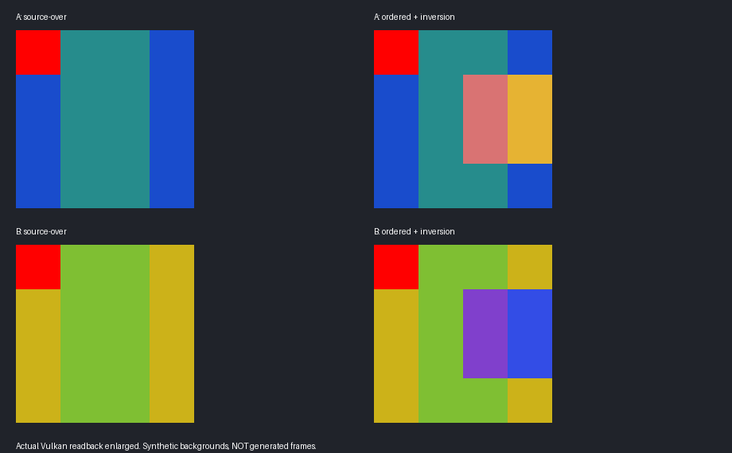

# GUI 分离可行性与呈现边界

2026-10-22，按 81 号执行书完成一轮有界调查。结论：建议保留现有 Vulkan GUI 执行器，局部改为独立、有序且持有资源版本的屏幕绘制包；不建议重写全部 GUI。世界／GUI 资源与请求分离可实施，但固定 Streamline 2.14.1 的公开 Vulkan 接口尚不能实现已证明的“每个生成帧之后，由应用独立绘制全部 GUI”。本轮到可行性检查点停止，未实施阶段 4 产品功能。

## 问题

使用者已明确阶段 3 目视验收通过，本轮只研究下一阶段。三项优先风险为：SDK 的 UI 重组不等于 GUI 绕过 FG；屏幕效果、透明层与 GUI 3D 的深度和次序不能拆错；不同呈现频率下的纹理、附件和命令寿命不能继续只按真实帧结束推断。

“分离”需要分别判断：请求和资源独立；普通真实帧结果保持原语义；GUI 在真实生成帧上不被插值。这三项不能相互代替。GUI 不独立提高动画或输入更新频率，仍按原版真实帧提取状态；若未来希望以显示帧频更新输入和 UI，需要另定时序合同。

## 方法

读取阶段计划、adr-13、当前状态，以及已完成的[边界实验](experiment-takeover_boundaries.md)和[原版收尾](investigation-vanilla_drawing_closeout.md#严格-fg-后-gui-的有界核查)。不改写这些历史记录，也不重复其失败的失焦 FG 用例。

当前产品基线仍为 `components/render_diagnostics/build/takeover-instancing/manifest.json`，对应使用者已通过的候选。本轮没有修改 Java、native 产品代码或 shader，未重新生成或替换阶段 3 冻结验收包，没有覆盖验收实例，没有启动 Minecraft、Prism、性能测量或第三方组合。

对照本机 `minecraft-references/minecraft-1.21.1/src/net/minecraft/client/renderer/GameRenderer.java` 的 `render`、`Screen.renderBackground` 与当前注入点；该参考包含 NeoForge hook，不能冒充完全无加载器的原版。实际目标版本读取 target.properties，当前为 NeoForge 21.1.259。SDK 以 [Streamline.cmake](../../components/native_renderer/cmake/Streamline.cmake)下载并使用的头文件和文档为准，另核对同标签的[官方 FG 指南](https://github.com/NVIDIA-RTX/Streamline/blob/v2.14.1/docs/ProgrammingGuideDLSS_G.md)、[公开头文件](https://github.com/NVIDIA-RTX/Streamline/blob/v2.14.1/include/sl_dlss_g.h)和[手动 hook 指南](https://github.com/NVIDIA-RTX/Streamline/blob/v2.14.1/docs/ProgrammingGuideManualHooking.md)。

本轮最小运行验证在 `D:/Workspaces/Artifacts/Radiance/gui-separation-20261022/`，复用现有 framebuffer GPU harness 和实际 clear SPIR-V，在仓库外增加一个实验入口。没有新建正式诊断框架。两张合成背景上执行同一顺序：分数 alpha 面板 → 局部目标颜色反色 → 后画不透明 UI，并读回真实 Vulkan 像素。该实验检验“命令分离”和“固定 RGBA 贴图分离”的差别，背景不是 DLSS 生成帧，不据此验证 FG。

## 发现

### 当前实际顺序与归属

CPU 先记录请求，GPU 执行顺序由提交确定，两者不能混为一谈。

| 边界 | 当前入口和资源 | 必须保持的内容 |
| --- | --- | --- |
| 世界场景 | `GameRendererMixins.radiance$finishWorld` → `EntityProxy.build` → `RendererProxy.fuseWorld`；世界 PT、降噪／升频和颜色输出 | 世界内所有几何、第一人称手部及优先级成像仍按既有 PT 所有权管理；不因屏幕位置把它们改分为 GUI |
| 世界到屏幕颜色 | `PipelineContext::fuseWorld` 把 `worldPipelineContext->outputImage` 拷到当前 overlay 颜色；写入主目标深度，捕获 MainTarget 别名与 HUD-less | 世界结果、屏幕目标和原版读写 MainTarget 的依赖要可区分；目前已分开 command buffer，尚非独立 GUI 图层 |
| 世界后处理 | `UIModuleContext::postEntityEffect` 在 HUD 前执行 creeper／spider／invert；再次捕获处理后的 HUD-less | 原版处理对象和先后不变；蜘蛛多眼的附件图不能缩成一次 alpha 混合 |
| 摄像机屏幕覆盖 | `CameraOverlayRenderer` 在 GUI 前执行方块窒息、水下／流体、火焰，保留原版与 NeoForge 回调 | 这是屏幕效果；不搬进世界几何，也不改成无条件 source-over |
| GUI 主段 | 原版第一次 GUI 深度清除处开始 `GUI` scope；恶心覆盖、物品激活动画、HUD，随后按原版再清深度；Overlay 或 Screen、保存提示、toasts 和最后 flush | 投影、GUI scale、深度清除、遮挡、裁切、混合／写掩码、文字与层顺序；不能只包住 Gui.render 或 Screen.render |
| GUI 3D／离屏 | `RasterDrawBridge`／`DrawTargetContract` 路由到现有 UIModule；颜色、depth/stencil 和 FBO 附件实际执行 | 物品及实体预览仍用各自原始光照和局部深度；写附件→采样→叠加／读回不能延迟跨越依赖边界 |
| GPU 提交 | `Framework::submitCommand`：upload → world → 可选 UI PT → overlay → fuse；`fuseFinal` 标记 FG 输入并拷最终色到交换链代理图像 | 先完成写入和转换再给 SDK 消费；不能把 CPU 记录到某处当成 GPU 完成 |
| 最终呈现 | `Framework::present` 调 Streamline hook 后的 vkQueuePresentKHR；SDK 异步呈现 | SDK 的真实／生成帧队列、输入消费完成和最终呈现寿命由呈现所有者协调 |

overlay 色是 RGBA8 UNORM，主深度是支持时的 D32+S8，否则 D32；它们与世界最终颜色、HUD-less、R32 UI alpha 是不同资源。分离时保留现有颜色空间和转换位置，不顺手改成线性混合，否则淡出、字体边缘和反色都会改变。菜单无世界时也须独立正常工作，Early Window 的 SERVICE 生命周期不并入世界 FG。

### 决定成败的 SDK 边界

本机固定 SDK 2.14.1 的第 6.6 节与公开头文件明确：UI Recomposition 分别插值 HUD 和场景。第 6.7 节的 onErrorCallback 只处理异步错误，并非绘制回调。DLSSGState 提供输入消费完成 fence 和呈现计数，不返回可由应用后合成的生成帧纹理。

当前 StreamlineRuntime hook 的 Acquire／Present 是 SDK 的代理路径；在应用 vkQueuePresentKHR 返回之后再绘制，既不能取得其内部生成帧，也没有正确的逐帧所有权。手动 hooking 只是改变截获方式；其公开 Vulkan hook 清单没有新增逐生成帧后合成入口。Backbuffer subrect 只保护不相交区域，不能让覆盖在同一世界像素上的 HUD 绕过 FG。

因此，**当前公开集成路线没有可实现严格目标的已证入口**。这不是“任何未来 SDK 或 NVIDIA 专用接口均不可能”的结论，也未证明所有关闭 Recomposition 的组合都会怎样显示 UI；本轮不猜测隐藏接口，不改 DLL、不在错误回调中绘制。

旧边界实验真实生成计数为零，本轮不拿它充作通过；本轮实验完全未调用 DLSS-G，真实生成帧、焦点条件、呈现节奏和动态视觉继续是未验证。缺少接口不能用禁用 FG、真实帧截图或静态 UI 掩盖。

### 最小 GPU 概念验证

实验命令如下，均从仓库根运行；实验源码和摘要保存在上述外部目录。

```powershell
cmake -S D:/Workspaces/Artifacts/Radiance/gui-separation-20261022 -B D:/Workspaces/Artifacts/Radiance/gui-separation-20261022/build -G "Visual Studio 18 2026" -A x64
cmake --build D:/Workspaces/Artifacts/Radiance/gui-separation-20261022/build --config Release --target gui_split
& D:/Workspaces/Artifacts/Radiance/gui-separation-20261022/build/Release/gui_split.exe components/native_renderer/build/v/src/shader/shaders/overlay/clear_vert.spv components/native_renderer/build/v/src/shader/shaders/overlay/clear_frag.spv components/native_renderer/build/v/src/shader/shaders/overlay/clear_2_frag.spv --gui-split D:/Workspaces/Artifacts/Radiance/gui-separation-20261022/result
```

在 RTX 4080 SUPER／驱动 617.14 上运行一次，启用 Khronos core 与 Synchronization Validation，正常退出。原版 blend 方程及 scissor／次序是预期值，逐通道最大偏差 1/255；验证层错误为零，不以这一点证明所有同步正确。

- **一致**：两种背景独立执行相同有序 GUI，均与原混合方程一致。普通 source-over 分离后重组的最大残差 0.002353，处于 2/255 容差内。
- **有差异**：用背景 A 的最终图和 alpha 反解一张固定 UI，再放到背景 B，局部反色的裁剪后最大通道差为 0.901961。未裁剪代数残差为 1.40196；它不是全屏平均像素误差。反色对背景的系数可以为负，普通 alpha 的非负透过系数无法表达。
- **无法比较**：实际生成帧上的 UI 动态、全部真实 GUI 页面、不同输出频率、resize／重载与新的资源退休，本轮没有新客户端或产品实现，不能报通过。

图 1 是亲自检查过的真实 GPU 读回放大图：上排背景 A，下排背景 B，左列普通覆盖，右列加入局部反色和后画 UI。示例说明需要保留操作，不是对 Minecraft 最终画面的验收截图。



本轮 `spotlessApply`、`check verifyCompliance --strict` 成功，严格合规 0 失败／0 警告；check 中的 74 项 native CPU 测试通过，其余未改动的 Java 测试由 Gradle 判定 up-to-date。没有重跑完整 GPU／兼容矩阵，也未因纯调查重新运行 verifyRelease。与阶段 3 源码清单逐条核对的 1,437 个产品源文件无差异，冻结验收包与使用者实例保持不变。命令摘要与结果保存在同目录 `result/manifest.json`、`result/document-check.log`。

新实验最初因 std::array 到 VkClearColorValue 的实验包装不匹配而编译失败，修改仓库外包装后编译和运行成功；没有产品缺陷、设备丢失或真实 GPU 转储。既有加权模糊、字体、depth/stencil、离屏读回与原版巡检证据继续引用历史研究，不为本次无关文档改动机械重跑。build 目录为可再生中间物，检查点时移入回收站；源码、结果、manifest 与像素读回保留，重新执行命令可重建。

### 建议接管方式与备选

建议采用**局部分离，保留原 Vulkan GUI 执行器**。原版 GUI、菜单和回调仍每真实帧运行一次，不要求重写所有 Screen／Gui／Font；按已有 scope 收集三种有序节点：普通独立覆盖、依赖目标背景的屏幕运算、离屏生产与消费。可把连续普通覆盖缓存为 premultiplied RGBA 段；遇到模糊、反色、读回或深度边界就封段，不把全部 UI 强压成一张图。

最小接口职责草案如下，是建议而非已实现 API：

- WorldFrame 持有场景 epoch、帧号、尺寸、色彩契约、完成依赖、世界颜色／深度／motion；不包含屏幕 HUD。
- ScreenFrame 持有有序 draw/effect/target 依赖，以及每次请求发生时的矩阵、uniform、viewport/scissor、blend、纹理代际和必要的字体页／顶点资源强引用。重放 GPU 请求，不重新执行 Minecraft 的动画、事件或输入读取。
- 呈现适配器只有实际具备“逐输出帧图像＋可等待的完成依赖＋后合成入口”才声明严格能力；SDK 缺少时明确报不具备，不能填一个空 post-FG 回调。此能力判断不预先实现通用 FSR／跨 SDK 框架。

普通真实帧顺序建议为：世界 PT／升频结果 → 原版规定的世界后屏幕处理 → 摄像机覆盖 → HUD／GUI 分段及其依赖 → 最终呈现。GUI 自有 3D depth/stencil 保留；需要世界 MainTarget 深度或采样的请求显式依赖 WorldFrame，不偷换为空 GUI 深度。MainTarget 的采样、附件替换和同步读回仍是执行屏障。

若将来具备严格 FG 后入口，先仅插值世界，再对每张实际输出图执行同一 ScreenFrame；不增加原版 renderer／回调次数。屏幕包、纹理和 descriptor 需活到最后一次生成帧消费完成，而不是仅 Java 返回或应用提交 fence 完成。当前按交换链 image index 的数组也须带重建 epoch；resize 沿既有停新提交、等合法完成后重建的流程，不用每帧全局 idle。此处只定义实施时必须验证的不变量，未证明现有批次可直接跨频率重用。

| 路线 | 代价与语义 | 建议 |
| --- | --- | --- |
| 只保留当前执行方式，分清请求／资源 | 最小，先改善所有权；仍向 SDK 提交 GUI 相关输入，严格 FG 目标未实现 | 可作为第一步，明确阶段未闭合 |
| 局部 ScreenFrame＋有序目标图 | 复用 GUI shader、光栅、字体、GUI 3D；对目标背景效果保留操作和资源，避免重复 Java 绘制 | 首选；先完成非 FG 部分并与已验收基线对照 |
| 全面重新实现所有 GUI renderer | 重做字体、布局、导航、动画及 NeoForge hook，仍拿不到 SDK 生成帧后接口 | 无必要，收益和风险不匹配 |
| 现有 SDK Recomposition | 标准集成可继续使用，但 UI 仍参与 SDK 处理 | 只有使用者接受较弱 FG 目标时才作为交付，不擅自替换严格目标 |
| 独立透明窗口／系统合成 | 普通 alpha 可能可行；背景反色／模糊、全屏、HDR、输入和节奏另有不等价风险，未实测 | 不作为完整方案，不在本轮穷举 |
| 新的官方逐输出帧接口或可控呈现后端 | 有机会满足严格目标；当前未取得能力证明，涉及新的集成和许可边界 | 接口先行验证；不可先承诺全阶段完成日期 |

### 预计覆盖正确性与反例

下表是基于源码、已有对照和本轮最小实验的工程主观判断，不是测试通过率；只覆盖本阶段原版和当前加载器，深改第三方留第二节。

| 功能族 | 预计实现把握 | 依据、主要反例与待证部分 |
| --- | --- | --- |
| 菜单、HUD、文字、普通透明覆盖与淡出 | 高 | 现有 Vulkan 执行和字体生命周期有原版对照；本轮 source-over 分离成立。整段 alpha 累积、GUI scale、输入反馈和消失／出现仍需真实页面回归 |
| GUI 3D 物品／实体、cutout、foil 和局部深度 | 较高 | 继续用现有程序和原版姿态，避免重写；共享 bufferSource flush、HUD 后清深度、GUI 3D 与 tooltip 重叠是反例 |
| 局部反色、暗角、模糊、UI 后再模糊 | 中等偏高，条件为有序命令保留 | 本轮已反证单张 RGBA；现有 affine／weighted blur GPU 对照可复用。跨段采样、透明 UI 后再滤波及同目标反馈要实测 |
| 摄像机屏幕效果、世界后处理和读回 | 中等偏高 | 保留当前原版顺序；世界快照、HUD-less 与最终色的处理一致性，截图和 RTT 依赖不能错位 |
| 重载、resize、场景切换与帧间资源寿命 | 中等 | 已有真实帧退休可复用，跨生成帧持有与不同频率目前未实现；不能以旧 F3+T 通过代替新呈现寿命证明 |
| UI 不经 DLSS 插值而出现在每个生成帧 | 当前方案阻断，无法给可靠成功概率 | 缺少公开后合成入口和真实生成帧验证；不凭局部 GPU 读回给乐观百分比 |

### 工作量预估

单位为熟悉本项目的一名渲染工程师的有效人日，按 6 小时专注工程工作估计，包含定位和一次纠错，不是模型墙钟时间或交付承诺。以下为保留现有 Vulkan、原版限定范围、无第三方新适配且不降低任何语义的估计；各列不重复计数。

| 包 | 开发 | 集成 | 验证 | 前提和置信度 |
| --- | --- | --- | --- | --- |
| 世界／屏幕目标与资源边界、普通 GUI 分段 | 2～4 | 1～2 | 1～2 | 复用已有 scope／光栅，置信度中等偏高 |
| 背景依赖、GUI 3D／离屏、颜色与深度顺序 | 3～5 | 1～2 | 2～3 | 不做固定 RGBA 总图；原版状态对照，置信度中等 |
| 真实帧生命周期、重载／resize 与输入反馈收尾 | 2～3 | 1 | 1～2 | 跨输出帧仍需另行 SDK 前提，置信度中等 |
| 非严格 FG 的逻辑／资源分离合计 | 7～12 | 3～5 | 4～7 | 共 14～24 人日；范围是当前原版，不包含完整严格 FG |
| 严格 FG 后合成 | 未能估计 | 接口成立后暂估 2～4 | 接口成立后暂估 3～5 | 开发取决于未取得的官方接口；不能把条件估计当作可开工总量，置信度低 |

如果只允许一次很小的后续切片，建议先做 2～4 人日的“WorldFrame＋普通屏幕段”开发，再用旧／新原版页面输出证明没有改变；它不等于阶段 4 全部完成。若使用者要求整阶段必须同时兑现严格 GUI 绕过 FG，建议暂缓完整实施，先解决 SDK 接口，不先花两周重写 GUI。

## 结论

阶段 3 已登记使用者通过，GPU 根因、1440p 长间隔、阶段 5 资源与性能开放项均保留。本轮 GUI 分离方案应调整为“保留执行器、局部拆分有序请求和资源”；普通覆盖可独立，背景依赖效果不能丢为固定贴图。最小 GPU 运行证据支持这一区分，不能证明生成帧动态正确。

建议有条件实施逻辑／资源分离；严格“FG 只处理世界、GUI 完全绕过”目前按固定公开 SDK 路线阻断。下一检查点应由使用者决定是先实施非 FG 的最小切片，还是先取得严格呈现接口能力。本轮已到 81 号唯一检查点，停止，不进入完整阶段 4、阶段 5 或第三方。
