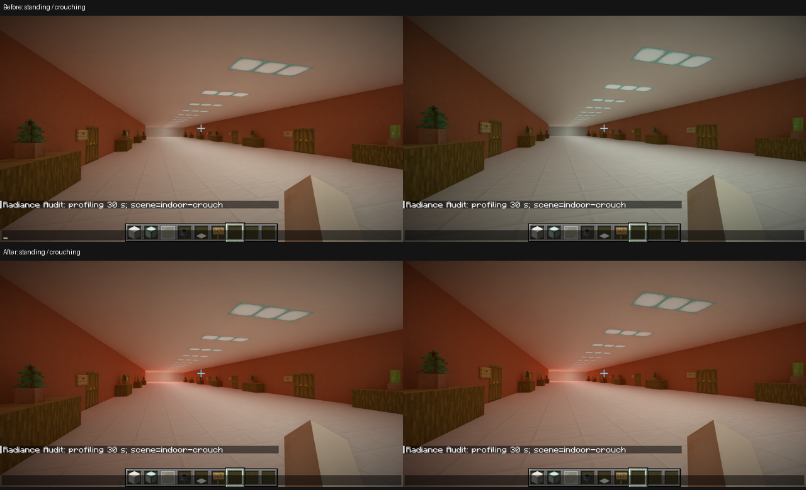

# 阶段 6 缺陷修复与室内下蹲复核

2026-10-21：已修复方块实体发布竞态、多几何命中表和历史矩阵层级错误；室内下蹲异常定位到 SHARC 训练首段错误使用传光查询域，修正后同步采样的站立／下蹲帧时间不再成倍变化。本记录覆盖指定城市、视距 8、Vanilla PT 四次反弹、SHARC 与 RR Balanced，不扩展为所有场景、Advanced 运行或长期稳定性通过；此前 1080p B2 的 291 ms 窗口仍未定因。

## 问题

按 60 号执行书收尾，阶段 7 不开工。[前次调查](investigation-stage6_manual_regressions.md)保留修复前事实。本轮先检查三个风险：正常重编译与槽位失效混淆；几何级 SBT 与实例级历史索引混淆；相机可见性与缓存训练／照明历史不一致。

## 方法

保留原版自动实例的城市存档、设置和操作位置，仅由自己的运行器暂时设置 1920×1080、静音。相机位于城市建筑走廊，脚点固定在 `(64.5,94,59.5)`，朝向不变；正常输入驱动两轮“站立→下蹲→恢复站立”。站立／下蹲相机高度分别为 95.62／95.27，不伪造姿态或焦点。

先完成最小 FRAME_ONLY 复现，再做每帧关联的 TIMED 采样。SHARC 统计只采每 16×16 launch 网格的一条路径，使用完成事件与帧退休后读取，无逐帧 GPU 等待。三次单帧捕获保存 RR 前后颜色、运动、深度及材质输入，捕获帧会额外复制和读回，不能将其尖峰当普通帧。原始 CSV／GPU 图像已无损归档并逐条读回核对 SHA-256，索引保留原文件名。

证据根为 `validations/visual-takeover_stages/result/`：

- 最小复现：`crouch-frame_only-20261021-025141/`，20／2／20／2／20 秒。该入口随后发现仍加载生产者观察 Mixin，引起合法安全回退，故其时间只作现象复现，不能当正常接管性能。
- 修复前有效同步样本：`crouch-timed-20261021-030720/`，8／2／8／2／8 秒，实际 PARTS 与 BAKED 为直接路径，原生队列归零。
- 修复后有效同步样本：`crouch-timed-20261021-031324/`，相同序列、相同设置。每个目录的 `launch.json`、`loaded-core.json` 和 `result.json` 分别记录产物、实际加载及保存关闭；最终交付只从[当前清单](../../components/render_diagnostics/build/takeover-stage6-closeout/manifest.json)取身份。

初次 TIMED 的 `crouch-timed-20261021-030412/` 因探针漏选已有 vanillaPerformance 配置，触发来源退回和玩家盔甲断言，在测量前退出；已纠正入口，不放宽产品来源检查。两次更早的启动参数错误与一次未进入序列的预热用例也保留在各自目录，不计入有效样本。没有以反复重跑 GPU 故障获得通过。

## 发现

### 三处已确认缺陷

**有差异，已修复：** 方块实体的本帧不可变编译快照可在同一区段发布新版后继续使用；只有卸载、重定位或世界切换使所有者失效。生产 `SectionPresenceIndex` 的线程交错回归覆盖重新编译、移除再加入及世界重置，保留代际保护。修复前的真实索引类重现见 `D:/Workspaces/Artifacts/Radiance/stage6-manual-investigation/results.json`。

**有差异，已修复：** 刚性实例采用一项 shadow 加 G 项材质命中，历史矩阵每实例一项。生产场景写入器由三几何 A 后接单几何 B 的回归验证，分别防止第二几何命中 shadow 和 B 读取 A 的历史。修复前按生产循环与 Vulkan SBT 寻址公式的失败算例保留于同一文件。该城市的刚性多几何计数为零，不能拿城市截图冒充多几何 GPU 命中实测；表布局证据来自生产写入器及消费者索引合同。

**一致：** 七类来源重新执行原版／候选对照：告示牌、悬挂告示牌、蜘蛛、末影人、苦力怕以及 WIDE／SLIM 玩家。覆盖眼睛、装备、手持物、轮廓、可见部件和动画变体；位置容差 3e-5、法线 5e-5，其余属性按原有精确规则。结果为同步样本的 `source-comparisons.json`，没有用 renderer 类名或自己编造的期待替代原执行。

### SHARC 首段查询域错误

**有差异，已修复：** 原缓存更新从相机起射后立刻关闭 direct-image 位，并一直使用 `queryTransport`。正常画面隐藏的自身和优先级几何因此可成为训练首个表面；同步样本中站立时采样的 112／112 条训练首段都命中 0.75 格以内。实际画面查询却从可见世界开始，训练与消费不对应。

| 序列段 | 修复前帧中位数 ms | 修复前 PT GPU 中位数 ms | 修复前缓存命中率 | 修复后帧中位数 ms | 修复后 PT GPU 中位数 ms | 修复后缓存命中率 |
| --- | ---: | ---: | ---: | ---: | ---: | ---: |
| 站立 | 23.276 | 21.266 | 0.23% | 7.615 | 5.314 | 98.4% |
| 下蹲 | 8.307 | 6.087 | 82.6% | 7.996 | 5.617 | 98.2% |
| 恢复站立 | 23.056 | 20.970 | 3.78% | 8.086 | 6.011 | 98.3% |
| 再次下蹲 | 8.304 | 6.201 | 84.6% | 8.146 | 6.149 | 98.3% |
| 最后静止 | 22.358 | 20.336 | 2.25% | 8.088 | 6.069 | 98.3% |

恢复站立段的命中率包含短暂残留；逐秒记录显示它随后再次跌低。表中 GPU 为整个 ray_tracing 模块，包含构建与缓存子阶段，不与这些子阶段相加。修复后训练更新自身的中位数由约 0.27 ms 增至 0.76～0.84 ms，新增的是实际可见世界训练工作；渲染端缓存恢复命中后的净收益已经体现在模块时间中。

修复后训练首段近身命中为零。没有逐图元标识将旧近身命中唯一定位到头部的某个三角形，根因结论限定为已证实的错误查询域，不虚构具体 primitive。

修复让训练从正常 direct-image 状态开始，透明／折射续接保留该状态，真实反弹后进入传光。训练排除只受光、不贡献世界照明的专用手部；后续传光仍包含自身及优先级几何，第三人称仍可训练可见身体。Advanced 中完全相同的入口一并纠正；本轮不新增其真实客户端压力验证。

SHARC 官方随版本集成说明要求相机采样路径与逐段更新，并在渲染命中缓存时结束路径，见固定子模块 `components/native_renderer/third_party/SHARC/docs/Integration.md`。本次未改变采样率、四次反弹、缓存参数、内容或画质，也没有通过关闭 SHARC 解决问题。

### 排除与图像

**一致：** 修复前后 DLSS viewport 不变，所测序列没有 history reset；运动输入有限，静止段接近零，改变高度时有对应运动。修复前色调差异在 RR 输入和输出中均存在，故不能归为 RR 重置。实例／几何数量仅有正常小幅动态变化，与三倍左右 PT 时间变化不对应。

CPU 时间源有 15.625 ms 量化，不能解释单帧 CPU 中位数为零；用窗口累计均值与 GPU 完成时间区分等待，不把量化值当零 CPU 工作。强插桩与单帧捕获改变了开销，以上是定向因果对照，不是新的整城市收益声明。

图 1 为实际截图：上排修复前站立／下蹲，下排修复后相同步骤。已亲自查看截图及固定映射的 RR 前后 GPU 捕获；修复后橙墙的暖色间接光仍存在，消除的是姿态触发的突变，不是人为中和墙面颜色。

## 结论

三处布局／发布缺陷与 SHARC 首段查询域错误分别修复，不能把前者记为下蹲异常根因。后者由同设置复现、GPU 缓存观测、RR 前后图像及单一合同修正后的消失形成因果链。

交付门槛执行 `spotlessApply check verifyRelease verifyCompliance --strict :native_renderer:gpuTest`。首轮因粒子合同仍要求错误的固定传光域而失败，保留 `final-gates.log`；按新旧行为证据纠正该补充源码检查，并给现有 GPU 查询用例增加缓存域断言后，全命令通过，证据为 `D:/Workspaces/Artifacts/Radiance/stage6-manual-investigation/final-gates-corrected.log`。74 项原生 CPU、22 项 GPU 回归通过，JNI、Java／bootstrap／probe 回归和发行包 155 个必需条目核对通过，严格合规 0 失败／0 警告。源码扫描只作补充，不替代 CPU 生产写入器、GPU 执行和实际原版对照。

冻结候选的正常配置复核为 `crouch-frame_only-20261021-033455/`，20／2／20／2／20 秒，不启用 SHARC 原子计数、单帧图像读回或来源双执行，保留默认轻量取证与 Aftermath。五段帧时间中位数依次为 7.508、7.432、7.918、7.988、8.325 ms，p95 为 8.988～11.262 ms；8,197 帧无记录丢失、缺口或失败帧。PARTS／BAKED 实际为直接路径；已亲自查看正常配置的五张截图，没有再见姿态触发的突然冷暖切换。

有效用例均记录世界保存完成、进程正常退出及 `normal-device-close`。没有新增设备丢失，不将那次探针断言退出混写成 GPU 失败；既有 GPU 根因及 291 ms 窗口仍开放。

最终 JAR、内嵌 GAME／core、构建／安装 core 及 PDB 对应关系固定于清单，正常配置实际加载 core 已相符。完整源码与 14 个 gitlink 为 `validations/conformance-vanilla/result/source-stage6-closeout-final.{json,zip}`，包括必要新文件，未纳入本机配置与生成内容。纯原版验收实例已按[短清单](../../validations/visual-takeover_stages/validation.md)刷新，不启动；保留两份存档和视距 8，2560×1440、音量 50%、音乐关闭、RecRivenVI，仅 NeoForge＋Radiance。三项新的目视结果待使用者反馈。

存储按既有规则处理：复制的客户端 runtime／probe 已回收；冷 CSV 与 GPU 捕获按 ZIP／SHA-256 索引逐条核对后回收原文件；另外回收了与冻结 JAR 同字节的 Gradle 发行收集副本，保留冻结包及原始门槛结果。没有删除唯一证据。不提交、推送、投放 Prism 或使用 Computer-Use；阶段 7 不开工，交验后停止。
