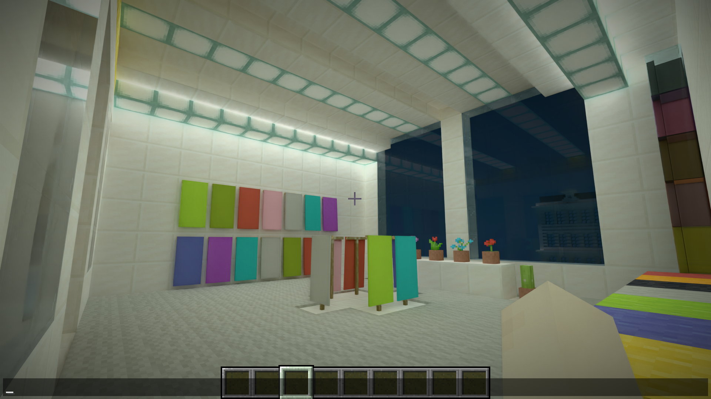

# 接管层实例化与动态输入归因

2026-10-21：阶段 3 的实例化主体、来源对照与三组 ABBA 已完成，候选待使用者目视。楼内 r8／1080p 两对帧间隔减少 9.15～10.50 ms，城市 r32／1080p 减少 15.59～15.98 ms。1440p 也更快，但基线出现未定因的主队列长间隔，不能概括稳定收益幅度。以下是同机有限窗口，不是长期稳定性、完整视觉等价或 GPU 根因闭合。

## 问题

已有[楼内调查](investigation-building_entity_drop.md)确认 CPU 生产与提交为主要限制，但尚未逐项归属动态输入。本轮不能改写原版来源方法引起安全退回，也不能把真正形变误当刚性资源。

## 方法

先验证三处风险：

1. **归因污染路径**：对 ModelPart／renderer 注入观察器可能触发来源退回，造成假动态输入；只在 Radiance 的请求、缓冲、入队与原生边界观察，并核对实际资格。
2. **错误判变与共享**：非均匀变换、滚动 UV、附加层、颜色／光照、资源重载与可见部件改变可能被冻结或串对象；以原版输出对照、历史和重载反例验证。
3. **增量发布生命周期**：复用 BLAS／TLAS／元数据时原地覆盖在途数据，或上一帧身份失效，可能导致错误命中与设备丢失；使用现有代际、完成退休与不可变资源版本，不以 GPU idle 规避。

先做短窗来源计数，再决定实现顺序；产品冻结后才执行楼内 r8／1080p及城市 r32／1080p、1440p 的交错配对。只用随机覆盖，内容和质量不变。自动静音，不使用 Computer-Use 或 Prism。

## 发现

编号与遗留项按 [adr-13](../design/adr-13-takeover_instancing_stages.md)同步。归因案例为 `validations/performance-vanilla/result/instancing/census-20261021-051714/`；`source-attribution.json` 汇总，`profiles/*/instance-inputs.json` 留前三帧每个输入的所有者、位置、renderer、模型与材质。111 帧的 Java 输入数和实际原生 BLAS 输入数都是 603，无漏项或重复；PARTS／BAKED／PAINTING／STATIC_STATE 资格均为正常兼容。此窗口有反射／计数开销，不作为性能结果。

| 来源 | 每帧输入 | 顶点 | 模型／材质 | 未复用原因 |
| --- | ---: | ---: | --- | --- |
| ChestRenderer | 250 | 18,000 | 单／双箱底、盖、锁；chest atlas cutout | 750 个部件版本请求被拒，模板重放 |
| BedRenderer | 232 | 16,704 | headRoot／footRoot 的 main、左右腿；bed atlas solid | 696 个部件版本请求被拒，模板重放 |
| BannerRenderer | 46 | 4,128 | pole、bar、flag；banner atlas solid／no-outline | 172 个部件版本请求被拒，模板重放；旗面是刚性部件姿态动画 |
| BoatRenderer | 30 | 720 | waterPatch 与船底形成的有限排水控制体；water_mask | 有意不走可见表面缓存，但仍每帧生成控制几何并分配 BLAS，世界准备随后只读取平面 |
| SignRenderer | 28 | 1,284 | SignModel 木牌与 Font 字形；sign atlas／字体页 | 8 个牌体版本被拒；其余含字体执行例外，需与牌体分别管理 |
| SkullBlockRenderer | 10 | 624 | SkullModelBase 的各头颅模型；龙／骷髅／僵尸／苦力怕／玩家皮肤 | 16 个部件版本请求被拒；模型从 renderer 的模型映射取得 |
| EnchantTableRenderer | 6 | 1,008 | BookModel 书页、封面、书脊；block atlas | 42 个部件版本请求被拒；开合是部件姿态变化 |
| ItemInHandRenderer | 1 | 48 | 第一人称空手的手臂／袖口，玩家皮肤两层 | HAND=8、相机原点；现存第一人称特殊执行例外，不是玩家隐藏躯干 |

前三帧明细总计约 42,516 个顶点。告示牌和头颅 renderer 的模型映射未由首次描述器展开到字段路径，但 renderer、实际材质与顶点来源均已记录；它们的模型取得路径从生产适配器核对，不强填未知部件名。

### 缓存拒收的实际机制

`PartModelCapture.localVersion` 同时受 512 项和 16 MiB 限制。窗口中 512 项仅使用 1,609,728 字节，版本构建数保持不变；新请求因为当前帧已使用的版本不能被逐出而返回 null。每帧 1,684 次部件重放全部标记为局部版本拒收，而不是非均匀姿态或真实顶点形变。此前楼内 1.6 MiB 的占用不足以说明缓存健康，固定项数才是此处的实际限制。

实现顺序据此确定：先把局部模板和绑定缓存的容量管理改为实际字节预算，保留当前帧与在途保护；恢复同一个局部模型／外观版本在多个对象间共享模型和 BLAS，再以实际内容变化驱动 TLAS 与元数据发布。控制体、文字和第一人称特殊输入与可见模型分别登记，不为本次接管另外重写 GUI 或字体执行器。

### 实例化主体与限定复核

局部部件仍使用原有 16 MiB、来源模板仍使用 8 MiB 字节预算，取消与几何大小无关的 512 项拒收；绑定记录按引用局部数据的 16 MiB 预算管理。原生驻留改为 64 MiB 字节预算，不再用 1024 项淘汰；包含 GPU 缓冲、CPU 几何签名，并对共享根资源保守重复计费，所以不是物理显存统计。当前帧使用中的资源不逐出，在途所有者继续由批次和完成退休持有。不同颜色／光照／overlay／纹理代际仍是独立的不可变外观版本，不能原地串写。

在模型版本首次进入原生驻留时，按转换后的完整位置、索引、几何顺序及 AS 标志作精确对照；哈希只选桶，字节相等才共享位置／索引和 BLAS。材质、UV、颜色、光照、附加层仍属各自版本。热路径不重新生成或哈希全部顶点；冷版本命中共享后仍有临时未记录的分配，但不再执行重复 AS 构建和位置／索引上传。别名强持有唯一根资源，根从缓存逐出不会使仍在使用的别名失效；没有新增 JNI ABI。

元数据重新按九张表的实际内容判变；相同内容复用，变化时写入新缓冲，上传完成依赖按现有边界批量发布。TLAS 对比完整实例序列，包括变换、遮罩、SBT 偏移、标志和所持 BLAS 对象身份；全相同才复用，其他情况仍合法重建。GUI 共同场景不走跨帧复用，避免把共享批次中未执行的 builder 当成已发布 TLAS。

容量修正后的中间候选楼内短窗 `census-20261021-054537` 中，前三帧动态输入都为 59：排水控制体 30、文字输入 28、第一人称手臂／袖层 1，共 1,860 顶点。原有 603 项中的其余部件均进入常驻实例；局部版本拒收归零，窗口前后模板构建计数同为 778。758 个局部版本仅用 2,380,800 字节。该中间包尚未加入后续跨外观 BLAS 共享，不与最终包运行结论混用。

193 帧中 192 帧的 Java 提交数与动态 BLAS 数逐帧相同；第 144 帧多一次 Java 提交，同时原生构建多出 6,524 个云顶点，但动态实体 BLAS 数仍为 59。`CloudProxy.queue` 的 miss 会经 `endCachedCloud` 从动态队列取出，单独构建常驻云；首版计数未区分此提交域，已补探针范围标记。该帧保留原始差值，不改写为零，也不据此判定漏绘。

中间候选截图与前次楼内基线截图均已人工查看，相同相机下旗帜、床、花盆、窗外景物及第一人称手臂未见结构性变化；不是原版 OpenGL 的逐像素等价证明。此短窗含归因开销，不下帧率收益结论。

自动回归直接创建 700 个实际局部 PBR 外观版本，确认可驻留、复用及纹理换代独立；满字节预算时本帧条目仍有效，下一帧才可逐出。实例输入对照回归确认姿态、遮罩、SBT、顺序、BLAS 替换及移除都会使复用失效。首次构建因目标路径缺少 `:version:` 失败；另一次原生编译与新增头文件写入重叠，头文件暂不可见，待编辑结束后重新构建通过，未归为运行故障。

首次探针编译因包内 `uniformPose` 不可直接访问而失败，已改为仅诊断反射调用，复编通过。首窗输出因漏选 profileControl 写入本实例默认 profiles 路径；数据完整，已移动到案例并记录 `profile-location-correction.json`，没有为换位置重跑。

存储预检前，旧 `performance-scene_diagnosis/result/profiles/` 的冷 CSV 已逐条读回核对后压缩为 `cold-evidence.zip`，各原目录有入口索引；原始 JFR 保留原文件。不是删除旧失败或历史证据。

阶段 2 的旧性能原始 CSV／日志 220 份共 239,342,292 字节，另归入 `performance-vanilla/result/stage2-cold-evidence.zip`（33,512,377 字节），逐条 SHA-256 读回后原文件移入回收站。摘要和原始 JFR 保持原位；本轮以验收候选重测，不复用其旧收益数字。

### 冻结候选的正确性对照

产品身份只写在 `components/render_diagnostics/build/takeover-instancing/manifest.json`。完整门槛日志为外部调查目录的 `instancing-final-gates.log`：原生 CPU CTest 74 项、GPU CTest 22 项均执行，无跳过；Gradle check／verifyRelease 与严格合规通过，严格检查零失败／零警告。新增原生回归直接使用资源所有者和完成退休机制，覆盖共享根被缓存逐出、未提交构建重录和提交后退休；不只验证一个独立缓存类。

`conformance-renderer/result/replacement-20261021-061236/` 对照 155 个登记来源：153 个实际替代，另 2 个保留捕获；285 个世界物品组合、9 种公共状态变更、重载和资格后事件更换模型均保留原输出。位置容差 3e-5、法线 5e-5，其余材质字节与层序精确比较；字体生命周期违规为零。`conformance-entity_takeover/result/foreign-20261021-061616/` 的未登记 Mixin 明确触发 PARTS 退回，仍与修改后来源一致。

生命周期首次编译前因探针陈旧被入口拒绝，未启动客户端；更新探针后，旧测试等待阶段 1 的 ModelPart.compile 观察入口，在 `lifecycle-20261021-063028/` 报错。阶段 2 已直接执行 renderer 状态，旧入口不再是有效标准。测试改为读取客户端实际收到的盔甲架姿态、装备和可见性，独立执行原 renderer 与接管路径；`lifecycle-20261021-064152/` 的六个状态检查点一致，重载后不复用旧代际，删除重建及 F3+A 后仍正确，断开后缓存清空。发光轮廓在该用例只核对同步标志，其几何由完整来源对照负责，不重复虚报。失败原始证据保留，未吞异常或放宽容差。

实际 Java 新生成量由探针在 Radiance 的 PBRVertexConsumer.endNullable 记录，两种结束批次方式都经此入口，和原生读取／逻辑上传分列；不把重复传递常驻 MeshData 的字节数当作本帧重新生成量，也不把逻辑上传当成 PCIe 实测。首版只观察 end，漏了普通实体入口；第一个已启动基线进程降为采集预检，主动设置分析暂停阻止第二个进程。该预检不纳入正式配对；修正只影响计量，不改变已通过的产品来源、生命周期或 185 帧数量核销。来源归因使用独立短窗，正式测量不启用重型 census。

最终短窗 `census-20261021-064545/` 已将单独云提交分列，185 帧的 Java／native 动态输入全部一致，仍为 59 项；窗口前后部件版本构建计数均为 809。相同相机下已亲自查看最终截图与基线，旗帜、床、花盆、第一人称手臂、窗外内容无结构性差异；旗面运动时刻和路径追踪随机噪声不作逐像素等价。该窗每帧 TLAS 仍重建，九张元数据表平均约 1.82 张复用，7.18 张变化；不把新增复用机制写成城市数据完全静止。

### 最终冻结配对

本机 RTX 4080 SUPER、驱动 617.14、16,376 MiB。基线为阶段 2 收尾验收包，候选为本轮唯一冻结包，12 个正式进程共用一个冻结探针。输入清单为 `performance-vanilla/result/instancing/fixtures.json`：楼内来自正常保存的人工入口，城市来自原冻结城市；每次重新解出相同输入，不在 A／B 之间继承游戏运行造成的存档变化。保持原版模拟、实体、动画、反弹、RR Balanced、Reflex、FG 关闭及随机覆盖，只改变指定视距和输出尺寸。

每个进程等全部队列连续平静后，分别采 FRAME_ONLY 20 秒与 TIMED 10 秒。按 A1、B1、B2、A2 执行；比较 A1/B1 与 A2/B2，不合并不同帧数的样本。下面单位为 ms，每个单元的两个值按 A1/A2 或 B1/B2 排列。

| 场景 | 基线均值 | 候选均值 | 两对差值（候选－基线） | 基线 p95／p99 | 候选 p95／p99 |
| --- | --- | --- | --- | --- | --- |
| 楼内 r8／1080p | 30.94 / 29.48 | 20.44 / 20.33 | -10.50 / -9.15 | 36.72/47.56；33.84/39.11 | 25.66/33.48；24.07/28.23 |
| 城市 r32／1080p | 51.89 / 52.64 | 36.29 / 36.67 | -15.59 / -15.98 | 61.13/70.45；60.82/73.18 | 40.77/51.87；40.69/48.73 |
| 城市 r32／1440p | 92.06 / 49.75 | 36.91 / 39.60 | -55.15 / -10.15 | 150.35/171.85；60.06/67.26 | 40.50/45.40；45.19/51.22 |

| 场景 | FRAME_ONLY 线程 CPU：基线 → 候选 | FRAME_ONLY 主队列跨度：基线 → 候选 | TIMED 帧间隔：基线 → 候选 |
| --- | --- | --- | --- |
| 楼内 r8／1080p | 30.69 / 29.27 → 20.24 / 19.71 | 13.33 / 13.11 → 14.53 / 16.80 | 31.04 / 29.16 → 19.41 / 20.22 |
| 城市 r32／1080p | 51.33 / 52.14 → 36.06 / 36.43 | 18.10 / 17.16 → 13.13 / 13.06 | 49.53 / 55.04 → 36.29 / 36.54 |
| 城市 r32／1440p | 57.75 / 49.09 → 36.67 / 39.22 | 80.62 / 22.09 → 25.30 / 22.36 | 67.02 / 54.01 → 39.15 / 39.70 |

GPU 数值是完成时间落入窗口的主队列时间戳跨度，可能包含等待和抢占，不是独占硬件忙碌计数；不从帧间隔中直接相减，也不相加重叠通道。完整 TIMED CPU/GPU 分段、每窗原始分布及采样数量在 `instancing/comparison.json` 和各案例的 `analysis.json`。

### 实际减少与成本转移

以下是 TIMED 每帧均值的两次运行范围；MB 为十进制逻辑字节，不是实测 PCIe 流量。新生成仅指渲染线程完成的 PBR 网格，不代表全部 Java 分配或纹理上传。动态 BLAS 输入不是 Vulkan 命令条数；常驻 BLAS 构建另计。

| 场景 | 新生成 PBR 顶点：基线 → 候选 | 几何逻辑上传 MB：基线 → 候选 | 元数据上传 MB：基线 → 候选 | 动态 BLAS 输入：基线 → 候选 |
| --- | --- | --- | --- | --- |
| 楼内 r8／1080p | 42517.548～42518.577 → 1860.155～1860.186 | 5.545～5.545 → 0.247～0.247 | 3.383～3.389 → 2.674～2.898 | 603.000～603.000 → 59.000～59.000 |
| 城市 r32／1080p | 44933.109～45192.681 → 1193.810～1199.029 | 5.724～5.737 → 0.154～0.154 | 23.448～23.463 → 4.327～4.471 | 251.035～252.560 → 48.000～48.000 |
| 城市 r32／1440p | 44326.400～45110.301 → 1172.159～1237.859 | 5.665～5.774 → 0.154～0.154 | 23.458～23.469 → 4.337～4.339 | 251.720～252.909 → 48.000～48.000 |

| 场景 | 常驻实例：基线 → 候选 | TLAS 实例：基线 → 候选 | 实体 BLAS GPU ms：基线 → 候选 | TLAS GPU ms：基线 → 候选 |
| --- | --- | --- | --- | --- |
| 楼内 r8／1080p | 2408.810～2413.892 → 4093.828～4096.101 | 5373.810～5378.892 → 6514.828～6517.101 | 0.91 / 0.89 → 0.13 / 0.13 | 0.22 / 0.20 → 0.20 / 0.19 |
| 城市 r32／1080p | 2610.391～2640.066 → 4121.812～4123.580 | 31650.426～31681.626 → 32958.812～32960.580 | 0.48 / 0.49 → 0.11 / 0.11 | 0.37 / 0.38 → 0.35 / 0.35 |
| 城市 r32／1440p | 2608.153～2622.586 → 4116.623～4120.887 | 31648.873～31664.495 → 32953.623～32957.887 | 0.65 / 0.43 → 0.12 / 0.11 | 0.64 / 0.33 → 0.35 / 0.45 |

候选三个场景的窗口中未记录到新常驻 BLAS 构建，基线存在少量反复构建。候选的全部 TLAS 计数仍为每帧构建一次：动态字体、云、粒子或姿态等变化仍需要更新完整实例序列。元数据是按整表判变，不是逐记录 GPU 场景数据库；实例状态提取和组织仍有逐帧工作。非均匀姿态、滚动 UV、特殊消费者继续保留精确模板重放，文字、排水控制体和第一人称例外未被改名为常驻路径。

楼内第一对 TIMED 的 BER 自身阶段 7.224 → 2.184 ms，几何打包 3.075 → 1.373 ms，提交／呈现 6.723 → 4.173 ms；实体自身阶段 7.808 → 7.573 ms，改善很小。阶段有嵌套，不相加。收益来自减少原本重复的生产与构建，尚未消除全部状态计算。

### 资源与逐窗并行负载

VMA 只覆盖本进程该分配器的请求字节；不包括所有驱动／SDK 占用。下表为 TIMED 窗口 VMA 峰值及两种窗口整卡 NVML 峰值，不混成同一种显存统计。

| 场景 | VMA 峰值 GB：基线 → 候选 | 整卡峰值 MiB：基线 → 候选 |
| --- | --- | --- |
| 楼内 r8／1080p | 2.809 → 2.765 | 9348 → 8457 |
| 城市 r32／1080p | 11.632 → 11.600 | 15554 → 15037 |
| 城市 r32／1440p | 12.376 → 12.367 | 15795 → 15563 |

每个进程下列两列按 FRAME_ONLY／TIMED 排列。观测到的其他游戏均为 Mine-Craft-Protocol，列出 PID；“无”只表示该窗口的游戏进程枚举未观测到，不等于没有其他 GPU 程序。

| 场景／轮次 | 整卡 GPU 利用率均值 %（F／T） | 观测到的其他游戏 PID（F／T） |
| --- | --- | --- |
| 楼内 r8／1080p A1 | 49.12 / 47.12 | 无 / 11184 |
| 楼内 r8／1080p B1 | 78.24 / 76.50 | 52440 / 52440 |
| 楼内 r8／1080p B2 | 90.65 / 67.78 | 96764 / 128620 |
| 楼内 r8／1080p A2 | 48.94 / 49.25 | 无 / 无 |
| 城市 r32／1080p A1 | 47.38 / 40.00 | 129468 / 无 |
| 城市 r32／1080p B1 | 37.50 / 40.00 | 无 / 无 |
| 城市 r32／1080p B2 | 40.31 / 36.12 | 无 / 无 |
| 城市 r32／1080p A2 | 36.73 / 34.88 | 无 / 无 |
| 城市 r32／1440p A1 | 84.35 / 92.50 | 无 / 无 |
| 城市 r32／1440p B1 | 73.75 / 55.22 | 28156 / 28156 |
| 城市 r32／1440p B2 | 59.93 / 71.89 | 100760 / 100760 |
| 城市 r32／1440p A2 | 46.13 / 44.14 | 无 / 无 |

1440p A1 的主队列跨度约 80.62 ms、整卡利用率经常 100%，显存接近整卡容量；同分辨率 A2 为 22.09 ms。没有证据将差异定为显存换页、驱动或某个外部进程。两对原始差值均保留，不删除 A1、不扩大重跑，也不据此承诺稳定的 1440p 提升幅度。该开放项归阶段 5。

原城市输入带有旧 map SavedData 的无效 dimension 警告。原阶段 6 的 A1 日志已经有 53 条相同错误，本轮未修改或删除地图内容；它是固定夹具边界，不是本候选新缺陷，有效地图的正确性依赖独立来源回归。

首个正式组在 A2 启动前被存储预留门槛拦住，未创建客户端；已完成的三个进程没有重跑。随后所有通过进程的 CSV／日志逐项 SHA-256 读回 ZIP 后，将原文件送入回收站，摘要及索引保留，再继续尚未运行的进程。各案例的 `RAW_EVIDENCE.json` 指向 `raw-evidence.zip` 与索引；失败生命周期证据仍原样保留。交付文档检查曾因新增截图尚未引用触发 D-08，已补引用，不作为产品故障。

## 结论

- **一致**：限定来源对照中，已改动的几何、材质、姿态和层序与原版输出在既定容差内一致；未知修改退回、重载、删除重建及资源清理保持有效。最终实际截图已查看，目视终验仍交使用者。
- **有差异，符合目标**：楼内的重复动态输入 603 → 59，新生成 PBR 顶点约减少 95.6%；城市窗口也显著减少重复输入与元数据上传。代价为更多 TLAS 实例和有界持久缓存。1080p 两场景均有同方向配对净改善。
- **无法比较为固定收益**：1440p GPU 时间波动大，不能从本次有限窗口给出可泛化的提升百分比。历史 GPU 故障根因和长期稳定性未闭合，期间未发生设备丢失，没有故障自动重试。
- 楼内候选约 49 FPS，城市候选约 25～28 FPS，尚未达到真实 60 FPS。状态提取、残留捕获和逐帧实例组织仍有成本，不以“已经实例化”代替性能结论。
- 完整产物／源码与短清单经现状页链接；准备原有纯原版入口，保留 r8 和楼内点位，不启动。未提交、推送、投放 Prism 或开展阶段 4／5及第三方工作。
