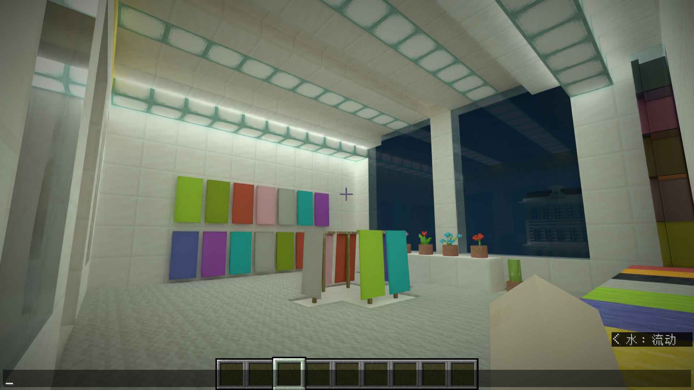

# 城市楼内密集实体掉帧调查

2026-10-21：使用者确认阶段 6 收尾缺陷目视通过并观察到明显提速，但在旗帜商店内从接近 60 FPS 降至约 30 FPS。本轮在保存点复现了低帧率，主要瓶颈定位到 CPU 实体／方块实体生产与原生提交链，不是区块仍在加载，也没有重现已修复的 SHARC 首段近身命中错误。本次只调查，不修改产品；没有楼外同条件配对，不能把单个 renderer 或缓存容量断言为全部掉帧的根因，也不从短窗推导长期稳定性。

## 问题

使用者不再使用视频设置“普通半透明”的“前景／背景混合”，验收和诊断都使用默认“随机覆盖”。实际保存的 `radiance/shaders/world/ray_tracing/vanilla-pt.zip.txt` 已是 stochastic，无需修改设置。此前收尾的通过反馈、新楼内现象及原配置保存在 `validations/visual-takeover_stages/result/building-entity-20261021-043737/`，不改写旧失败记录。

本轮先验证三个风险：密集实体／BER 的重复 CPU 工作；GPU 追踪或 SHARC 再次异常；加载队列、来源退回或并行游戏干扰。阶段 7 不开工。

## 方法

沿用[当前冻结候选](../../components/render_diagnostics/build/takeover-stage6-closeout/manifest.json)，实际加载 core 已核对。只运行项目内实例一次，保留城市、实体、相机和画质；自动实例临时使用 1920×1080、静音，结束后恢复人工入口设置。存档点 `(-136.3000,75.0625,218.7000)`，yaw `130.5000`、pitch `-8.4000`，视距 8、模拟距离 32、Vanilla PT 四次反弹、SHARC、RR Balanced、FG 关闭，时间 6000、天气不变。

加载后至少预热 60 秒、队列连续平静 10 秒，再按顺序采集 FRAME_ONLY 20 秒、TIMED 10 秒和 JFR_ONLY 20 秒。截图发生在计时外，另留 3 秒间隔；每种窗口的工具开销分别报告。TIMED 启用既有完成事件读取的 SHARC 稀疏计数，不加 GPU 等待；JFR 的采样栈不能当作精确耗时。

命令从仓库根目录执行，临时运行器保留于授权的外部工作目录：

```powershell
python -X utf8 D:/Workspaces/Artifacts/Radiance/stage6-manual-investigation/building_capture.py
python -X utf8 D:/Workspaces/Artifacts/Radiance/stage6-manual-investigation/analyze_building.py
```

该运行器拒绝重用已启动的案例，并在设备丢失时停止而不重试。轻量取证、Aftermath 与并行负载观察保持开启；没有开启重型验证。保存点、原手工日志、实际启动参数、CPU／GPU 原始 CSV、JFR、分析和正常关闭记录分别见案例中的 `saved-point.json`、`manual-evidence/`、`launch.json`、`profiles/`、`analysis.json` 与 `result.json`。

## 发现

### 已复现，主要受 CPU 限制

| 窗口 | 帧数 | 平均帧间隔 ms | p50 ms | p95 ms | p99 ms | 渲染线程累计 CPU 均值 ms/帧 |
| --- | ---: | ---: | ---: | ---: | ---: | ---: |
| FRAME_ONLY | 678 | 29.506 | 28.312 | 36.322 | 62.204 | 28.968 |
| TIMED | 328 | 30.537 | 29.155 | 40.044 | 53.277 | 30.202 |
| JFR_ONLY | 607 | 32.986 | 30.202 | 42.431 | 79.441 | 32.563 |

FRAME_ONLY 约 33.9 真实 FPS；GPU 主队列完成区间在 TIMED 均值约 13.013 ms，CPU 累计时间则接近帧间隔。它们相互重叠，不能相减求“Java 开销”；独立证据共同支持 CPU 是当前主要限制。JFR 窗口包括一次 345.8 ms 长帧，没有删尾；有工具和运行间波动，不把三窗当三次相同配置的独立重复。

所有窗口无丢失记录、帧号缺口或失败帧；CPU 时钟为 15.625 ms 量化，只解释窗口累计均值，不解释单帧零值。采样期间没有其他 Minecraft 客户端，但整卡遥测不是本进程独占或严格无外部负载的证明。

| TIMED 路径 | 均值 ms/帧 | 范围 |
| --- | ---: | --- |
| ENTITIES | 7.668 | Java 层自身墙钟分区，包含本地调用，不等同纯 Java 指令 |
| BLOCK_ENTITIES | 7.321 | 同上，与 ENTITIES 为独立分区，合计约 14.99 ms |
| GEOMETRY_MARSHAL | 2.985 | 整理与原生入队分区 |
| SUBMIT_PRESENT | 6.494 | 还包含原生场景准备，不能解释成纯 present 等待 |
| pt.prepare.blas-record | 2.044 | 原生自身时间，已在上层提交分区内 |
| pt.prepare.entity-metadata | 0.985 | 原生自身时间，同上 |
| entity.queue.pair-scan-le64 | 0.879 | 入队子阶段，不能再加到 marshal 上 |
| world PT pass | 8.349 | GPU 完成区间，属于 ray_tracing 模块 11.173 ms 内部 |
| entity BLAS | 0.849 | GPU 完成区间，属于同一模块 |

### 内容与剩余重复工作

**有差异：** 保存点附近 32 格内，NBT 中有 104 面旗帜、96 个箱子、48 个盔甲架、45 幅画和 20 个物品展示框。这是存档空间计数，不是逐帧 renderer 次数；其中箱子可能组成双箱，炉子等也未必有 BER。实景确为旗帜商店，图 1 已亲自查看。



每帧约 2,410 个刚性实例引用 99,201 个常驻顶点，同时还有 **603 个动态 BLAS 输入**与约 42,516 个输入顶点。世界 TLAS 约 5,375 个实例、7,150 项几何。持久模型的新输入平均仅约 0.23 个顶点/帧，构建约 0.058 项/帧，不能说所有实体仍在重新展开，也不能说持久模型完全失效。

PartModelCapture 的版本数停在上限 512，但该窗口 builds 没有增长；这只提示资格／容量可能让一部分路径留在捕获端，尚未测出拒收次数及来源，**不证明缓存抖动是主因**。603 个动态输入同样还不能逐项归到旗帜或盔甲架。

JFR 的 252 个渲染线程执行／原生采样中，63 次停在 `submitCommandNative`，27 次在 `queueBuildSourcesV3`；还有 16 次 `ByteBufferBuilder.resize/realloc`、8 次其构造／分配栈，以及区块状态和生物群系查询。这与分段测到的生产、缓冲准备和原生提交成本吻合；采样点不是毫秒，也不是 renderer 耗时排行榜。

**一致：** PARTS、BAKED、PAINTING 与 STATIC_STATE 来源检查保持兼容，没有因探针进入原版模型方法而触发安全退回。静态场景 2,391 项记录命中缓存，静态重建与区块队列均为零；这次重点不是重做静态缓存或恢复区块调度调查。

### 与已修复室内异常的区别

**一致：** SHARC 稀疏查询命中约 75.17%，训练首段近身命中为零；DLSS viewport 不变，history reset 为零。GPU 仍有约 8.35 ms 的世界追踪成本，缓存命中率也不是全部场景都能达到此前走廊的 98%，但旧“隐藏近身几何污染训练”的失败签名未出现。没有证据要求再改查询语义。

本次世界保存、进程退出及 `normal-device-close` 正常，无设备丢失和 GPU 转储。Aftermath 的 dumps=0 不是失败转储缺失，也不关闭历史 GPU 根因。

## 结论

楼内掉帧已收敛到 **密集实体／BER 的 CPU 请求生产、剩余动态几何入队和原生准备**。还没有逐来源完整归因，不能断言“就是旗帜”或把 603 项等同 603 个对象。本次不是产品修复，没有新发行候选或净收益声明。

建议下一项工作沿阶段 7 目标，先对 Radiance 自己的替代入口和缓冲所有者做短窗计数，保持原版来源方法不被诊断 Mixin 改写；明确 603 项的 renderer／材质来源和缓存拒收原因，再优先消除可证明不变输入的重复准备与短寿命缓冲重分配，批量提交姿态／外观。不能通过减少对象、禁用旗帜动画或忽略反射／阴影几何提速。只修分配不足以承诺从 30 直接到 60 FPS。

产品与着色器未修改。探针只增加默认关闭的定点截图入口，实际图像读回留在计时外；`probeClasses probeTest` 通过。生成的 runtime、着色器缓存及探针 JAR 已按回收站规则清理，人工入口恢复原分辨率／音量且不启动；存档位置保留。不提交、不推送、不操作 Prism；旧成功用例的三组原生文本跟踪逐条校验后无损压缩为各自 `native-traces.zip`，唯一证据未丢失。
