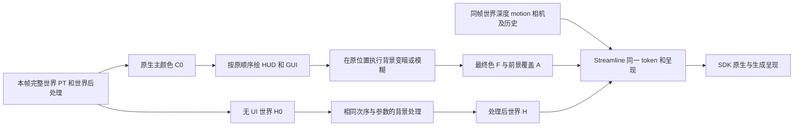

# 按实际画面分类的 GUI 补帧调查

2026-10-22，按 105 号执行书确认：有世界背景的 GUI 可以规划 UI Alpha 路线，暂停和模糊本身不应成为一律关闭 FG 的理由；没有世界、以全屏图像替换世界或输入无效时关闭。主要工作不是移除布尔门控，而是明确背景处理与前景的归属、解决 HUD 后模糊的分解，以及保持暂停时真实的逐帧输入。本轮只调查并提交[实施计划](../project/plan-gui_frame_generation.md)，没有修改生产代码、着色器或启动游戏；[91 号](investigation-vulkan_gui_takeover.md)与[96 号](investigation-gui_frame_generation.md)原样保留。

## 问题

使用者已决定按实际画面选择 UI Alpha 或停用 FG，研究让变暗、模糊后的世界背景继续参与 FG。三处优先风险是把整屏变暗误计为 UI、把暂停模拟误计为冻结图像，以及没有生成帧正计数却宣布方案可用。只限 1.21.1-neoforge、现有 Vulkan GUI 与 Streamline 2.14.1，不推进第三方接管或 GPU 专项。

## 方法

以当前脏工作区而非 HEAD 代替源码事实。沿 `GameRendererMixins`、`ScreenEffectCoordinator`、`ScreenMixins`、`UIModuleContext`、`DlssFrameGeneration` 和独立加载绘制路径核对调用顺序；读取 96 号保留的实际输入与 SDK 记录，没有重跑客户端或测性能。

Minecraft 参考源码来自 `D:/Workspaces/References/minecraft-references/minecraft-1.21.1`，其来源是 NeoForge 21.1.250 的开发源码。为避免将旧加载器当作当前版本，比较了 21.1.250／21.1.259 userdev 中全部 39 个 GUI Screen 补丁：内容无差异，NeoForm 坐标同为 `1.21.1-20240808.144430`；另以 `javap` 读取本项目实际 21.1.259 开发 JAR 中的 Screen、容器、GameRenderer、Minecraft 与 DeltaTracker 字节码。共盘点 20 处背景方法定义，包括嵌套类；这只是源码入口盘点，不是 20 项运行通过。

原始入口、字节码、资源读数及方法正文的索引为 `D:/Workspaces/Artifacts/Radiance/gui-fg-classification-20261022/manifest.json`。官方部分重新访问固定 SDK 指南与示例；社区部分复用 96 号固定提交与原始证据，不将旧 Wiki 当作最新能力。没有创建新二进制、世界副本或另一套诊断框架。

## 发现

### 分类表

“UI Alpha”表示应用允许该路线，仍须用户开启 FG、硬件／插件可用、输入合法且实际窗口满足 SDK 条件。运行／暂停以 `Minecraft.isPaused()` 的实际值为准，不由 Screen 名称推断。下面是规划目标，**生产仍执行 96 号门控**；新增路线均未实测。

| 实际来源或状态 | 世界背景与模拟 | 背景处理顺序 | 前景覆盖 | 目标 FG 模式 | 输入有效性与未确定项 |
| --- | --- | --- | --- | --- | --- |
| 普通 HUD、热栏、聊天、调试文字 | 有；通常运行 | 世界后处理后绘 UI；聊天不调用默认整屏背景 | 文字、槽位、物品、提示保留真实覆盖 | UI Alpha | 沿用当前世界深度／motion；生成帧动态仍未验证 |
| 反色十字线 | 有；随游戏状态 | 按原位置读取最终背景反色 | 保留 96 号已求值 RGB 与 A=1 | UI Alpha，单列质量项 | 不保证在生成背景上重新执行反色；不能称严格 GUI 后置 |
| 背包／创造物品栏／容器 | 有；容器 `isPauseScreen=false` | `renderTransparentBackground` 灰色渐变 → 容器底图 → 内容 | 底图、物品／玩家 3D、配方、提示均为 UI | UI Alpha | 3D 的局部光照、depth 与遮挡不纳入世界深度；窄窗口配方分支另验 |
| 告示牌、书、命令／结构编辑 | 有；实际模拟可暂停 | 多数覆盖方法调用透明渐变，再绘本地内容 | 纸张、编辑控件、3D 预览仍为 UI | UI Alpha | 不能因继承 Screen 的暂停标志停用；编辑器预览逐来源验收 |
| 单人未开放局域网的暂停页 | 有；模拟暂停，图像仍每帧重绘 | HUD → 模糊 → 整屏菜单变暗 → 控件 | 包含被模糊的旧 HUD，不能偷偷归入世界 | UI Alpha | 保留真实当前 depth／motion／相机和 token；静态背景不代表有可观收益 |
| 多人／已开放局域网的暂停页 | 有；世界通常继续 | 与暂停页相同 | 同上 | UI Alpha | 与单人相同的 Screen，模拟状态不同；移动实体与背景为判别项 |
| 游戏内选项、视频、声音及嵌套页 | 有；实际模拟可能暂停 | 默认背景方法按“模糊 → 菜单变暗”执行 | 滚动列表的局部底色、控件、提示为前景 | UI Alpha | 模糊半径、窗口／GUI 尺寸、返回父页与重建必须形成正确历史边界 |
| 同一选项页从标题进入 | 无世界；全景图不是世界 | 全景图 → 模糊 → 变暗 → 控件 | 全部属于非世界界面 | Off | 即使图像在动也不伪造世界深度／motion |
| Radiance 自身设置页 | 按当前世界是否实际可见 | 走同一 Screen／GUI 路径；部分调用不止一次背景 | 普通控件与列表 | 条件 UI Alpha／Off | `ShaderPackScreen.render` 显式背景后还调用 super；不得按“一页一次”去重改变现有画面 |
| 死亡页及其确认页 | 有；`DeathScreen.isPauseScreen=false` | 红色渐变 → 标题／控件 | 文字、按钮及提示为前景 | UI Alpha | 渐变含有颜色，不只是乘亮度；确认页是否暂停看实际模拟 |
| 标题、选世界、连接、断线等无世界页 | 无世界 | 各自全景、列表或背景 | 全部为界面 | Off | 不把缓存的上次世界当本帧输入 |
| ReceivingLevelScreen、GenericMessageScreen | 当前世界被替换 | 门纹理／末地程序或强制全景图 → 控件 | 加载信息 | Off | 即使 level 指针尚在，也不等于看到世界 |
| ErrorScreen、末地诗的全屏替代背景 | 世界不可见 | 不透明渐变或末地程序 → 内容 | 全部为界面 | Off | 以替换行为而非暂停标志判定；普通片尾的默认背景分支仍按实际世界判定 |
| ProgressScreen／进度页 | 条件；不能只按名称定 | 继承默认背景时，有世界就模糊／变暗，无世界就全景 | 进度文字／控件 | 条件 UI Alpha／Off | 生命周期若没有合法当前世界输入则 Off；不是所有名为“进度”的页都相同 |
| 全屏不透明加载覆盖层 | 世界完全被挡住 | 当前加载场景或 clear 替代 | logo／进度 | Off | 资源重载未完成时也不能仅凭 worldRendered 开启 |
| 加载淡出尾段 | 可能重新看到世界 | 原世界／Screen → 部分透明的加载画面 | 加载 logo 与覆盖色为 UI | 输入合法后可走 UI Alpha | 独立 loading renderer 的 alpha 尚非 coverage，须先修接缝；重载提交与本帧世界输入未就绪时 Off |
| 未能核对的背景运算／来源修改 | 未证明 | 不猜 shader 名或材质名 | 保留原实际绘制 | Off，仅禁 FG | 明确记录不支持的合成原因；不删除 UI 或世界几何，不冒充已覆盖第三方 |

20 处覆盖方法均可落入上述来源族；继承路径另沿默认 Screen、容器和实际调用者核对。它不是对所有 GUI 嵌套、资源包和运行状态的动态证明，后续运行清单见计划。

### 不能只删暂停判断的实际原因

1. **普通背景变暗目前按普通 UI 累加 coverage。** 当前菜单纹理在实际资源 JAR 中是 16×16、黑色、alpha=64；容器渐变则为 `0xC0101010` 到 `0xD0101010`。二者都应作为已知背景操作，而不是把整屏计为 UI。只删 `isPaused` 或 `postBlur` 的否决会继续给 SDK 一张大面积 UI 遮罩。
2. **接管应窄于整个 renderBackground。** 容器覆盖方法在变暗后立刻绘容器底图；社交页在 super 背景后绘局部面板。把整个方法都标为背景会将真实控件写进 HUD-less。应接管透明渐变、完整菜单背景这类具体调用；列表中的局部同纹理绘制仍是前景。
3. **批次可能晚于语义作用域执行。** `GuiGraphics`／字体有批处理，Java ThreadLocal 临时标志本身不足。最小方案在背景调用两侧 flush，再将角色随现有 native 状态快照传递，不改变 RGB 顺序，不让背景标志污染随后字体／3D。
4. **加载器不经过普通 UI coverage。** `loading_renderer.cpp` 的 alpha 混合当前为 `SRC_ALPHA / ONE_MINUS_SRC_ALPHA`，输出是 `a_s² + (1-a_s)A_d`，不是 coverage 所需的 `a_s + (1-a_s)A_d`。它在 96 号中被 FG 门控排除，因此不是本轮新复现的画面故障；但不能直接用它的 alpha 开启淡出尾段 FG。GAME 与早期窗口／离屏画布须分别处理，不能全局改混合。
5. **世界图像不因模拟暂停自动冻结。** 当前 GameRenderer 在合法世界帧继续 renderLevel，DeltaTracker 只保持游戏插值时刻，GUI 使用另一路帧时间。实际暂停还取决于单人服务端、是否公开及 NeoForge 钩子。不能将新颜色配上旧深度／motion，也不能把所有暂停帧的 motion 强制清零。

### 原生帧与生成帧的数据流

原生帧保持原调用顺序，FG 辅助分支另行维护；不把世界／GUI重排成新的可见画面。

**变暗／着色**可直接分解。令 `F=U+(1-A)H`，已知背景操作为 `D(X)=KX+T`；按实际来源对 F 和 H 同时执行 D，保持 A 不变，则新的前景为 `KU+AT`，仍满足合成方程。容器灰色渐变与死亡红色渐变不能只用一个黑色乘数替代。GPU 仍执行原 draw 的 RGB；辅助 H 用同一纹理、变换、裁切和 blend，alpha 保留，不按颜色差生成遮罩。

**HUD 后的模糊**有更严格限制。设 B 是源码中的线性模糊，直接用 `H'=B(H)`、`A'=B(A)` 并不能保证前景残差是合法预乘颜色。例如两个像素 `H=[0,1]`、`A=[0,1]`、黑色前景 `U=[0,0]`，平均模糊后 `F'=0`，但独立背景为 0.5、遮罩为 0.5，要求前景为 −0.25。普通 UNORM UI 无法表达；这是一项代数反例，不是本轮新 GPU 实验。

当前加权算法 `H'=B((1-A)H)/B(1-A)` 正是为了保留这项协方差：能与模糊后的 F／A 精确分解，但 H 会受 UI 遮罩影响，**不等同于独立的 B(H)**。因此不能将其直接改名为完全独立的世界背景，或仅因旧测试通过就宣布符合新目标。

推荐首个候选采用：辅助分支对纯世界执行 B；对于被 B 读取的旧前景，按相同滤波支撑范围形成**已求值前景覆盖**，这些位置 A=1，颜色仍用原生 F；未受旧前景影响处 A=0，之后新控件照常累加分数 alpha。等价于将这部分背景依赖结果视为已求值 UI，避免负残差，同时保持原生 RGB。此表示有意不保留那部分旧 UI 的原始分数 alpha，不能冒充精确恢复；它会把小范围背景颜色烘入前景，生成帧中的动态质量须单独验证。普通未模糊 UI、附件 alpha 和菜单后画出的透明控件不改为二值。

这一路线与 96 号准星的已求值表示一致；如果某类 UI 的该代价不能接受，就仅对该实际合成禁用 FG，不退回“所有暂停页关闭”。不采用整屏 A=1 伪装支持，也不把 HUD 复制进 H。

### 深度、历史、颜色与资源合同

- 背景获取在 `PipelineContext::fuseWorld`／世界后处理完成处，保持同一场景 epoch 与帧编号；不从最终 GUI 截图回填世界。
- H、F、A 使用输出物理尺寸与原有 UNORM 颜色流程；深度与 motion 保持实际世界输入尺寸。模糊是颜色后处理，不把 depth／motion 也做颜色平均，不将 GUI 3D 深度混入世界。
- 保留世界当前位置、实际 motion、投影、抖动和原有 `slConstants` 契约。相机与几何确实不动时应产生相应的 motion，而不是由暂停布尔值捏造零向量。被模糊边缘跨深度的生成质量仍须实测。
- 暂停中继续本帧渲染与 SDK token／present；不实施新的暂停图像缓存，不推进模拟、不提高屏幕外更新频率。菜单动画可以继续，但静止背景的插值价值有限，不能承诺收益。
- 世界切换、资源重载、尺寸或背景处理拓扑的硬切重置 FG 历史；连续淡出／普通 UI 动画不每帧重置。只重置相应 FG 历史，不顺便重置全部 PT 缓存。
- 复用现有在途帧图像、不可变描述符与退休边界；短暂 Off 保留资源，长期用户关闭走现有插件卸载／释放。不开第二个呈现所有者，不增加每帧全局 idle。

### 官方合同、社区与项目判断

[固定 2.14.1 指南](https://github.com/NVIDIA-RTX/Streamline/blob/v2.14.1/docs/ProgrammingGuideDLSS_G.md)§5 要求 H 与最终色具有对应后处理、正确的 UI 覆盖和合成关系；所以“有模糊就不可能 FG”没有依据。但 §6.4 明确建议全屏／大面积菜单停用，本次使用者选择在有世界背景且输入合法时允许开启，**属于有意偏离建议，不是官方推荐菜单 FG**。§6.6 的 Recomposition 仍会插值 UI；自动菜单检测既需要另一类输入又与本次目标相冲突，继续关闭。

[官方示例](https://github.com/NVIDIA-RTX/Streamline_Sample/blob/94da85b6594e6c5109e84f995f5969811014c71f/src/UIRenderer.h)支持分离颜色／覆盖后合成，不提供 Minecraft HUD 后模糊的现成解法。没有找到官方认可上述加权算法或已求值覆盖对所有 GUI 动态等价的保证；这两者是项目分析，不能靠引用指南替代验证。

[OptiScaler 的固定 Vulkan 实现](https://github.com/optiscaler/OptiScaler/blob/fa44a4a8353fa2efc4e22dc5da4260515606d717/OptiScaler/hudfix/Hudfix_Vk.cpp)从候选资源或 UI 反合成获取输入，已有资源绑定与候选判定的修复记录，见 96 号报告。这是兼容 hook 的代表性做法，不是本项目应改用的来源推断；我们有明确背景调用和资源所有权，应直接表达意图。没有证据称社区已普遍解决任意背景依赖 UI。

## 结论

新目标可实施，但不能只删除 96 号的暂停／模糊否决：须先把真实背景效果与 UI 分开，再处理模糊依赖和加载 alpha，最后统一决定输入与历史。建议的[分步计划](../project/plan-gui_frame_generation.md)给出接口、检查点、工作量、容量和验收条件。

本轮源码调查一致确认这些路径；新分类的生成帧效果**无法比较**，因为没有启动客户端，且 96 号的 SDK 焦点门槛与零正计数仍开放。下一轮先核对 SDK HWND、真实 GLFW 与系统前台，不自动激活或伪造聚焦。没有用旧输入捕获／截图替代新方案通过；到 105 号唯一检查点停止，等待后续实施安排。
