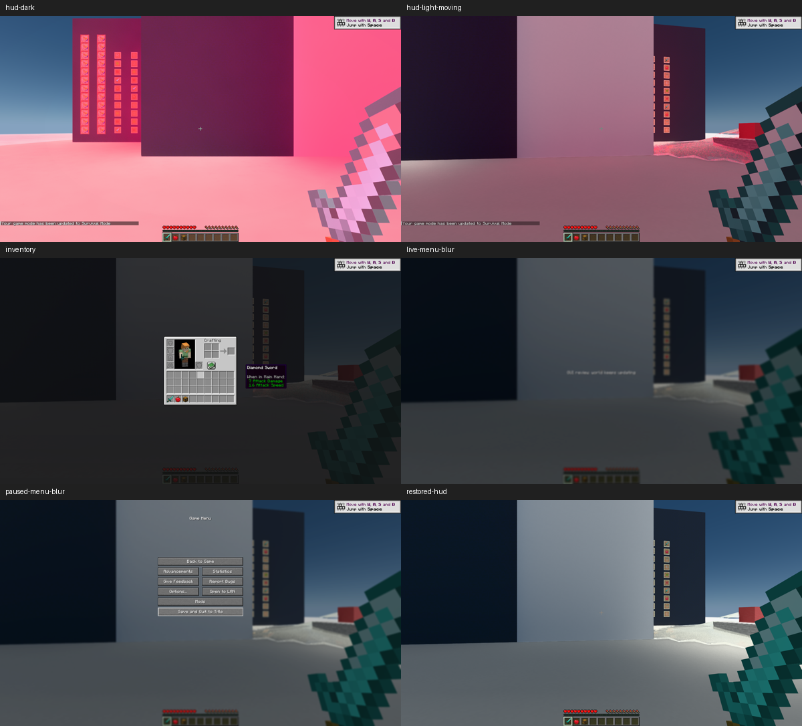
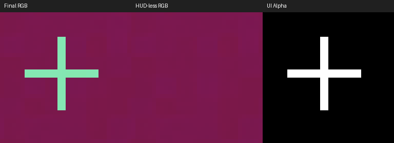

# GUI 补帧输入、暂停策略与社区方案调查

2026-10-22，按 96 号执行书修复反色准星的 HUD-less 污染、暂停／模糊菜单的启停和无效自动菜单检测，并修复验证时发现的 FG 插件未加载问题。限定原生帧、输入读回和相关回归一致；尚未取得实际生成帧正计数，最后一轮明确停在 SDK 的窗口焦点门槛。修复后完成新的联网调查；本记录不改写 [91 号报告](investigation-vulkan_gui_takeover.md)，不宣称严格 GUI 绕过补帧或生成帧视觉通过。

## 问题

三个优先风险是背景依赖混合被错误分入世界、暂停／恢复破坏资源寿命，以及把请求开启、SDK 可用或普通截图当成实际生成帧。范围仅 1.21.1-neoforge、现有 Vulkan GUI 和固定 Streamline 2.14.1；不升级 SDK，不推进第三方或阶段 5，不操作人工实例。

## 方法

先核对实际来源混合和固定 SDK 合同，再实施有限修复、组件／GPU 回归与两次预先登记的项目内客户端运行。均为 1920×1080、静音、仅产品与探针，不注入宿主输入或激活窗口，不测性能。第二次包含第一轮暴露的插件加载修复；两轮结果不混为同一候选。

实际测试包和各内嵌成员的唯一交接身份为 `components/render_diagnostics/build/gui-fg-fix/manifest.json`；完整源码见 `validations/conformance-takeover/result/source-gui96-final.{json,zip}`。构建、运行、原始 SDK 计数与新下载资料的索引集中在 `D:/Workspaces/Artifacts/Radiance/gui-fg-fix-20261022/manifest.json`。对照采用 91 号保存的原实现截图和本轮实际来源绘制，不以自写缓存测试独立证明视觉等价。

两次运行正常保存关闭后才进行本节的联网调查。保存了固定版本和最新 main 的原始指南、diff、官方示例、社区源码及 GitHub API 的日期／提交／热度数据；只参考合同与思路，没有搬入第三方实现。

## 发现

### 官方权威推荐

权威基线是 [Streamline 2.14.1 指南](https://github.com/NVIDIA-RTX/Streamline/blob/v2.14.1/docs/ProgrammingGuideDLSS_G.md)。本次重新查询的 main 固定在 [625db07d](https://github.com/NVIDIA-RTX/Streamline/blob/625db07d4bca5abc67d781c42af7e7fb0761f1b6/docs/ProgrammingGuideDLSS_G.md)，其标题为 2.14.16；实际文本 diff 只有版本标题变化。这里比较的是文档，不表示本机已安装新版 SDK。

| 场景／合同 | 官方明确要求或建议 | 本项目判断 |
| --- | --- | --- |
| 普通 HUD、热栏、透明界面 | §5 要求 HUD-less 是 UI 前画面；遮罩在无 UI 处为零、有 UI 处非零，并符合预乘覆盖方程。单通道 UI Alpha 为性能优先选项；输入尺寸与后处理须对应 | 保留来源 source-over、替换及附件 alpha 的区分；物品栏不能从最终色差猜覆盖率 |
| 反色准星 | 未找到官方针对 Vulkan 反色准星的专门配方；普通 UI 方程不自动表达任意背景依赖运算 | 从 HUD-less 移除准星，原始 RGB 反色保留；以完全覆盖的已求值 UI 表达，属于项目推导，生成帧背景变化时的准确反色尚未证明 |
| 背包 3D、提示与透明层 | 按实际 UI 输出提供覆盖与颜色；UI Recomposition 将 UI 和场景分别插值再合成，不是 UI 完全不插值 | 保持现有 Vulkan 深度、局部光照及绘制顺序；背包继续世界模拟，不因 Screen 存在就停 FG |
| 暂停、加载、全屏菜单 | §6.4 建议显式设为 Off；短暂停用建议保留资源，长期关闭仍需释放 | 用应用已知的暂停、加载 overlay、PauseScreen 和实际全屏菜单模糊决定，不等待猜测结果 |
| 自动菜单检测 | §6.5 要求 UIColorAndAlpha 和检测标志；仍优先应用显式停用，且自动识别不保证命中全部菜单 | 当前仅有 UIAlpha，移除无输入前提的检测标志；不为了自动检测另建 RGBA 缓冲 |
| Vulkan 与 D3D | Vulkan 由代理 acquire／present 与既有二值同步衔接；D3D12 特有的 waitable-object、动态 MFG 等条件不等于 Vulkan 支持 | 保留现有 Vulkan 呈现／寿命机制，不搬用 D3D 专属流程，也不改成无等待并行队列 |

[官方示例固定提交 94da85b6](https://github.com/NVIDIA-RTX/Streamline_Sample/tree/94da85b6594e6c5109e84f995f5969811014c71f)的 `UIRenderer.h` 实际提供 UIColorAndAlpha、UIAlpha 和同时标记的策略：先绘 UI 目标，再合成并标记；`StreamlineSample.cpp` 保留 PreUIColor。它支持正确输入与合成边界这一建议，但不证明任意 Minecraft 反色或后续模糊都能直接照搬该 RGBA 路径。[示例 README](https://github.com/NVIDIA-RTX/Streamline_Sample/blob/94da85b6594e6c5109e84f995f5969811014c71f/README.md)另区分 D3D12 的切换重建与 Vulkan 全 API hook，不能据此添加第二个呈现所有者。

### 社区代表性做法与证据等级

GitHub API 的 2026-10-22 快照中 OptiScaler 为 11,967 stars、最近推送 10-21；Nukem 为 4,977 stars、最近推送 2025-03-16；官方示例为 40 stars、最近推送 10-16。星数只是项目关注度，不是某种 GUI 技术的采用率，以下称代表性做法，不声称业界主流。

| 来源、日期与固定位置 | 实际做法 | 代价、适用性与限制 |
| --- | --- | --- |
| [OptiScaler fa44a4a8](https://github.com/optiscaler/OptiScaler/tree/fa44a4a8353fa2efc4e22dc5da4260515606d717)，GPL-3.0 | `hudfix/Hudfix_Vk.cpp` 跟踪图像、绑定与候选顺序；选择 HUD-less，或捕获最终 UI 并尝试反合成。不是掌握源绘制边界的原生集成 | 需要资源跟踪、复制、阈值和游戏适配；Radiance 已知来源，没理由改用猜测 |
| [10-15 Vulkan HUDfix 提交 3b43b9ea](https://github.com/optiscaler/OptiScaler/commit/3b43b9eaf5e17e79be8307524486d918dc1a39a4)，[10-17 阈值修正 333778c6](https://github.com/optiscaler/OptiScaler/commit/333778c66b0be8eae9bbacaf7309508d3c51f847) | 前者加入 HUD-less／UI 捕获与反合成；后者清除升频残留 compute 绑定，防止内部图像成为下一次游戏 dispatch 的错误候选 | 是可回查的近期实际修复，不代表任意游戏有效；4 月 [OptiFG Wiki](https://github.com/optiscaler/OptiScaler/wiki/OptiFG)仍写仅 DX12，已不能独立描述当前源码能力 |
| [Control 问题 #1179](https://github.com/optiscaler/OptiScaler/issues/1179)，09-25～09-27 | 使用者报告 HUD 拖影，维护者回复该游戏的 HUDfix 成功与否依场景；HDR／输出选择也影响结果 | 问题关闭不等于所有 HUD 缺陷已修，不能把特定游戏配置当作 Vulkan 推荐 |
| [PR #1089](https://github.com/optiscaler/OptiScaler/pull/1089)，08-03 提交、09-16 关闭 | 作者报告重排 reset／深度／motion 捕获后改善 D3D12 场景转换 | API 确认未合并，维护者拒绝按该形式接收；只记作未经采纳的调查记录，不以作者长时测试作为可信通用修复依据 |
| [Nukem 0e253f63](https://github.com/Nukem9/dlssg-to-fsr3/tree/0e253f63c3c66ee7582406bfa3dec698df7ab2c1)，GPL-3.0 | 替换既有 DLSSG 后端，沿用原游戏输入；README 记录 Vulkan 与格式兼容的实验边界 | 有历史关注度，但本轮查询不是活跃更新项目；不是独立解决任意 GUI 绘制语义的方案 |

没有找到足以证明“反色准星统一使用某一种标准方案”的官方或多项目采用证据。社区 hook／反合成路线的存在，也不构成本项目必须放弃明确来源与 Vulkan GUI 的理由。

### 实际修复与调用边界

| 问题 | 实际修改与保留项 |
| --- | --- |
| 反色准星污染 HUD-less | `ui_coverage.hpp` 把背景反色与暗角衰减分开；`UIModule::prepareRasterDraw` 保持原反色 RGB，只将已求值片元记为 A=1，不再向 HUD-less 重放。暗角等衰减仍按原顺序处理；普通附件不强改 alpha |
| 真暂停／模糊菜单继续补帧 | `GameRendererMixins` 每帧传递应用许可，JNI 写入本帧 `fgGameFrame`；真实菜单 `postBlur` 进一步撤销该帧许可。`isGameFrame` 同时要求世界已渲染与应用许可。Off 保留短期资源，恢复重置历史；不修改用户开关，不将所有 Screen 一刀切 |
| 自动菜单输入不足 | 去掉需要 UIColorAndAlpha 的自动检测标志；保留 UIAlpha＋Recomposition，明确应用启停负责方 |
| 开关为真但插件未加载 | 第一轮实际未加载 FG 插件。旧 `recreatePresentation` 只检查 surface 是否需要重建，插件尚未加载时该检查可能不变；第二候选将插件已加载状态与请求状态不一致也作为重建理由。仍通过原 wait／reset／加载／swapchain 重建顺序，不跳过在途等待；无 Streamline 时不阻断正常重建 |
| 请求／可用被误当成实际插帧 | 在现有 capture 开关后记录实际 SDK token、status、呈现数及同次 CPU 呈现编号／图像／许可，不增加另一条 GetState 查询或永久逐帧日志 |

未改着色器、世界几何、画质、队列所有权或 SDK 版本。Java JNI 从一个 boolean 变为两个，提交头文件由 `generateJniHeaders` 重新生成，之后配套构建并实际加载新 DLL。探针悬浮提示直接调用原版 `GuiGraphics.renderTooltip`，证明实际字体／提示绘制，不冒充物理鼠标悬停验收。

### 真实输入、画面及呈现证据

图 1 来自最终第二候选同一次 1920×1080 运行，等比例缩小。已亲自查看六张原图和对照图；与 91 号保留画面相比，准星反色、热栏／背包 3D、菜单模糊／按钮和关闭恢复未见新差异。早期色调过渡在旧包中也存在，不拿随机世界色调逐位差作 GUI 结论。新增提示文字可见、透明层次正常。这里全是原生帧，不是生成帧截图。

图 2 为最终候选 GPU 输入中心 32×32 原始像素的最近邻放大。最终色有准星，HUD-less 没有，UIAlpha 的 68 个准星像素全部为 1；整张 alpha 有限且处于 0～1。RGB 方程和实机读回共同证实输入归属修复，不能据此证明 SDK 在生成背景上重新执行反色。

| 运行与结果 | 实际边界 |
| --- | --- |
| `gui-fix1-20261022-143540` | 343,930 个登记请求全消费，未归属／重复／未知为零；正常保存关闭、F3+T 与离屏附件／字体回归通过，无设备丢失。没有 SDK 状态样本，日志明确插件未加载。这一轮不是最终包的插帧证据 |
| `gui-fix2-20261022-145307` | 329,107 个请求全消费，三项异常计数为零；上述回归和正常收尾通过。实际加载 DLL 已核对；SDK FG 插件、HWND 关联和代理 swapchain 创建均有日志 |
| 最终 SDK 计数 | `sdk-evidence.json` 将 2,042 次实际查询关联到 token、呈现、图像及探针阶段。全部 status=0、实际呈现数=1，**额外生成正计数为零**；不能以 status 成功或请求开启填补此门槛 |

最终阶段统计：暗背景 HUD 209 次、亮背景／移动 286 次、背包 296 次均允许游戏帧；继续世界的模糊菜单 308 次、真暂停 312 次及暂停保持 307 次全部撤销游戏帧许可；恢复段 324 次中 322 次允许、两次属于转换帧。世界在背包／非暂停菜单推进，真正暂停时停止；用户 FG 开关保持请求为真，应用按帧决定是否执行。

14:54:11，SDK 明确输出 `DLSS-G disabled: window not focused`，随后本轮无生成正计数。同期 GLFW 报 focused=true、visible=true、iconified=false。**最早剩余边界已缩小到 SDK 的窗口焦点插帧门槛；二者为何不一致仍未知**，不把 GLFW 状态写成 Windows 前台证明，也不擅自激活窗口验证。没有第三次自动启动、重复崩溃或故障注入。

### 自动回归、交付检查与存储

`mcvr.ui-coverage-contract` 和 `mcvr.failure-state-contract` 覆盖真实状态分类、应用 FG gate、插件状态切换；`mcvr.framebuffer-gpu`、`mcvr.fg-ui-gpu` 覆盖真实 GPU coverage、原 RGB 反色、模糊与附件。四项均通过，第二候选另重跑受插件修复影响的状态回归。两轮实际客户端补齐上述真实调用接缝，不重跑无关城市矩阵。

最终按 W-02 执行 `spotlessApply`、`check verifyRelease` 与 `verifyCompliance --strict`，结果和命令输出集中在本轮 manifest。发行验证可能重打包 ZIP 时间戳，交付身份保留实际第二轮测试过的原 JAR；不以重新打包后的外层哈希替代运行身份。

按本轮硬线要求，先对自有旧实例内的重复 profile CSV／噪声缓存逐个核对保留副本，再回收 51 个文件共 346,747,721 字节；另回收无构建／文档引用的旧 `components/native_renderer/build/cmake` 生成树 1,327,668,194 字节。清单、大小及对应保留副本见本轮回执。未删除独立 `RadianceFeasibility`、引用输入、唯一证据或用户实例；两个复制客户端已在正常关闭后回收，原始日志／截图／输入留存。字面外部总量仍包括独立目录，不改变口径隐去超限。

## 结论

本轮唯一检查点的修复、相关回归及随后联网调查已经交付；**真实生成帧正计数和动态视觉仍无法比较，因此不把 96 号全部条件写为通过**。正常帧 GUI 与限定旧实现一致；输入和菜单启停的已知差异已修；严格 GUI 后置于 FG 未实现。

官方输入方案与当前明确来源方向相符；社区经验进一步说明不宜改用阈值猜测或盲目反合成。最小下一项是经用户安排一次保持真实前台的同候选会话，同时核对 SDK 使用的 HWND 与 Windows 前台，取得 SDK 正计数后再判断动态 UI；本轮不自动启动该会话。

之后人工短清单：明暗／移动背景的准星是否跳色；热栏、背包 3D 和提示是否重影；模糊暂停界面停止补帧且关闭恢复；仅在有效生成计数下裁决文字与准星动态质量。未验证任意第三方 Screen、自定义逻辑运算、非当前窗口尺寸的动态 FG、长期稳定性或性能收益。无提交、推送、部署及公开二进制授权。
