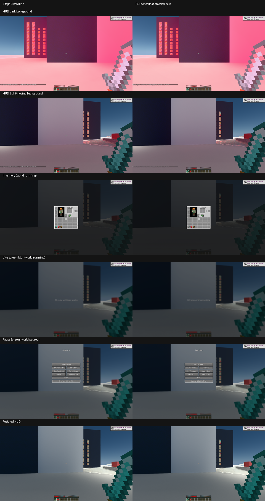
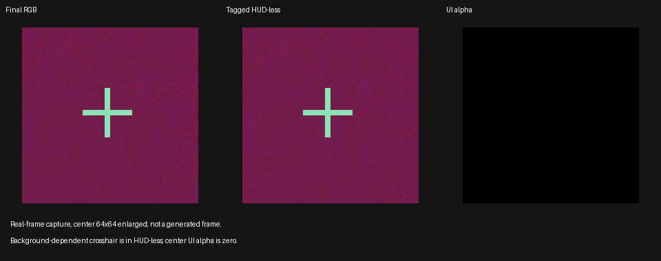

# Vulkan GUI 整理与 DLSS FG 官方核查

2026-10-22，按 91 号执行书完成现有 Vulkan GUI 的公共绘制准备整理。原生帧的限定场景与原实现一致；准星反色、暂停启停和自动菜单检测与官方输入／策略建议仍有差异。本轮没有改这些策略，没有实现全面 GUI 分离，也未取得生成帧动态视觉通过。阶段 3 的用户验收继续有效，[81 号研究](experiment-gui_separation.md)保留为历史记录。

## 问题

保留现有 Vulkan GUI，把来源适配、共享状态与执行职责整理到实际公共入口；核对准星、HUD 物品栏／背包及模糊暂停界面。优先风险为绘制顺序变化、把背景运算当作普通透明覆盖、以及描述符／输入图像在呈现前失效。第三方、阶段 5、SDK 升级和 FG 启停策略不在本轮。

## 方法

以使用者验收过的阶段 3 冻结包为被替换前标准，来源身份见 `components/render_diagnostics/build/takeover-instancing/manifest.json`；不是用当前 HEAD 代替包含未提交内容的旧源码。对照其 `source-instancing-final.zip` 中的实际文件。当前产品、来源差异、探针、实际加载 DLL、运行案例与检查日志的唯一交接身份放在 `D:/Workspaces/Artifacts/Radiance/gui-review-20261022/manifest.json`，不在多篇文档重复哈希。

运行前登记两次客户端启动：阶段 3 基线与整理候选各一次。均使用项目内同一夹具和同一探针，1920×1080、静音、仅 Radiance／probe；不操作键鼠、激活窗口、使用 Computer-Use 或测性能。候选额外开启一次既有真实帧输入读回；基线未开启该诊断选项，不能写成两边均取得原始 FG 输入。一次候选启动前的存储预检拒绝没有启动客户端，释放自有可重建中间物后才执行尚未运行的候选。

官方标准为实际安装的 [Streamline 2.14.1 指南](https://github.com/NVIDIA-RTX/Streamline/blob/v2.14.1/docs/ProgrammingGuideDLSS_G.md)和调查时 main 固定提交 [625db07d 的指南](https://github.com/NVIDIA-RTX/Streamline/blob/625db07d4bca5abc67d781c42af7e7fb0761f1b6/docs/ProgrammingGuideDLSS_G.md)，配套核对本机 SDK 头文件。后者标题版本为 2.14.16；这两份文件正文相同，仅版本标题不同，原始文本与 diff 随证据保留。没有升级或下载另一套 SDK 运行库。以下“建议”是本项目判断，不能反写为官方已提供某项接口。

## 发现

### 实际整理与保留的区别

| 职责 | 整理前 | 整理后与语义边界 |
| --- | --- | --- |
| 来源适配 | BufferUploader／VertexBuffer 等入口进入 `RasterDrawBridge`；自定义布局由 `VertexArrayProxy` 接入；屏幕效果已有专用协调器 | 保留这些薄适配器、`RenderCaptureContract` 和 `DrawTargetContract`。Java 产品代码无变化，不另造 GUI 框架或重写原版 Screen |
| 状态合同 | 普通索引／自定义 VA 各自判断覆盖率、混合、背景依赖及目标 | `ui_coverage.hpp::drawComposition` 按实际 blend、logic op、附件状态区分替换、source-over、背景调制、其他背景操作和原始附件 alpha；不按来源或 shader 名猜测 |
| 公共执行准备 | 两条 native draw 路径分别准备描述符、切目标、处理背景、选 pipeline、设置覆盖率与动态偏移 | `UIModuleContext::prepareRasterDraw` 共用整段准备；两条路径仍在原调用位置执行，不改变排序 |
| 普通／特殊绘制 | 普通索引、tessellation 与自定义多缓冲／实例／间接 draw 有各自输入 | 仅合并相同准备。索引绑定、patch 校验、实例数量和 indirect 参数仍由各自执行，未将不相同的 draw 强塞成一种 |
| 屏幕和离屏目标 | MainTarget 的 alpha 用作 UI coverage；FBO alpha 保持来源语义 | `syncColorAttachments` 使用同一分类；附件清除、采样、depth/stencil、viewport/scissor、写掩码与读回不迁移或延迟 |
| 屏幕效果与资源 | `ScreenEffectCoordinator`／`CameraOverlayRenderer` 管理顺序；`UIModule` 管描述符和 FBO；FG 管最终输入 | 原版世界后处理、覆盖、GUI、模糊及最终呈现边界继续独立。复用已有不可变描述符表和 `FrameResourceRetainer`，不创建第二套寿命机制 |

产品源码相对阶段 3 只改变 `ui_module.{cpp,hpp}`、`ui_framebuffer.cpp` 和 `ui_coverage.hpp`，另扩充状态合同回归。没有 JNI ABI、shader 或 Java 产品变化。发行包差异是 core 与相应 runtime 索引；两个 PT shader ZIP 只改变目录时间戳，逐条内容一致；内嵌 GAME JAR 字节一致。完整差异见证据中的 `artifact-comparison.json` 和 `product-source-delta.patch`。

### 官方要求、当前实现与建议

等级：**源码**表示已核对真实调用链；**输入读回**表示真实帧资源已完成 GPU 读回；**限定运行**表示本轮真实 GUI 路径与原实现对照；它们都不等于生成帧目视通过。

| 官方要求／建议 | 当前路径与判定 | 本项目建议、证据等级 |
| --- | --- | --- |
| §5：HUD-less、最终色、深度／motion 与 UI 遮罩须正确对应；后处理、尺寸和颜色空间一致 | `fuseWorld`／世界后处理后捕获 HUD-less，最终图像和单通道 R32 coverage 在 fuse 阶段标记；保持现有 UNORM 混合。原生帧普通覆盖一致 | 保持实际来源 blend 与屏幕操作顺序；不为了接口形式改变颜色空间。源码＋输入读回 |
| §5：UIAlpha 表示 UI 覆盖，重组满足预乘 UI 加背景的合成关系 | 普通覆盖和未混合替换已有独立 coverage；准星反色及暗角被重放到 HUD-less、保持原 coverage，因而不是严格的“绘制 UI 前世界” | **有差异**：不要把代数分解成立等同于符合纯 HUD-less 输入语义。后续单列背景操作策略，不在本轮偷偷修改。源码＋输入读回 |
| §6.6：UI Recomposition 分别处理 UI 与场景 | 当前 `enableUserInterfaceRecomposition=eTrue` | 普通 UI 使用标准入口；该功能不是 GUI 完全绕过补帧。源码；生成帧无法比较 |
| 清单／§6.4：暂停、加载、全屏菜单等非游戏帧建议显式停 FG；短暂停用可考虑保留资源 | `record` 按用户开关、worldRendered、输入与能力决定；没有 `Minecraft.isPaused` 判断。真正 PauseScreen 中 FG 选项仍为 true；无世界时 worldRendered 条件关闭 | **有差异**：未来区分真正暂停、继续运行的背包和无世界菜单；不要对所有 Screen 一刀切。源码＋限定运行；本轮不改启停政策 |
| §6.5：自动全屏菜单检测有特定 UI 输入前提，不代替应用显式禁用 | 设置了自动检测 flag，但仅标记 UIAlpha，没有 UIColorAndAlpha | 不能宣称 SDK 一定能替应用识别菜单。后续决定是否实现明确的暂停策略。源码 |
| Vulkan §16：acquire／present 二值 semaphore 与输入写入顺序 | 当前先等 acquire 再写代理图像，最终提交后 signal present 等待；输入记录与呈现均由现有 Framework 协调 | 本次未改队列、semaphore 或寿命；D3D waitable-object 建议不搬到 Vulkan。源码 |
| §5／§15：应用负责 Vulkan 资源寿命；valid-until-present 不是 SDK 引用计数 | 四类输入以 `eValidUntilPresent` 标记；图像由 FG／帧成员持有，resize／销毁已有 interposer device-idle 边界 | 保留现有在途保护。本轮未启用跨队列无等待模式，不能拿应用 CPU 已记录命令当 SDK 已完成。源码 |
| §15.1：并行且不阻塞客户端队列时需正确处理输入消费完成 fence | 当前保持默认阻塞呈现队列，未启用独立队列无阻塞模式 | 没有为未来并行额外引入 fence／回调；切策略时另审。源码 |
| GetState 须与呈现协调 | 初始化阶段查询能力／尺寸；呈现路径查询实际呈现计数并缓存，Java 只读缓存。SDK 日志包含通用同步提醒 | 提醒本身不证明有竞态，也不把本轮零计数归因于该提醒。未验证所有交错；保持开放项 |

### 三类场景的实际调用

**准星**：Minecraft 1.21.1 `Gui.renderCrosshair` 使用 `ONE_MINUS_DST_COLOR`／`ONE_MINUS_SRC_COLOR`，不是普通 alpha。源颜色 S 对背景 D 的操作是 `S + (1 - 2S) * D`。当前公共入口保留 RGB 方程，并对 HUD-less 重放同一操作；因此最终真实帧保持原外观，但准星本身进入了被标为 HUD-less 的图像。官方两份指南均未找到可直接照搬的 Vulkan 反色准星专门方案。

**物品栏**：HUD 热栏先按原版绘制槽位、物品、文字及透明层；打开实际 InventoryScreen 仍继续推进世界。3D 物品／玩家预览使用原始局部光照与深度，不能归入世界 PT。提示仍由原版 Font／GUI draw 顺序接入，本轮截图没有触发物品悬浮提示；它的动态目视列为待验，而非补写通过。

**模糊菜单**：世界／HUD 已画到主颜色后，Screen 的实际背景流程调用 `ScreenEffectCoordinator` → `postBlur`。现有 `postOverlay(BLUR)` 先对已捕获 HUD-less 执行同参数加权模糊，再处理最终颜色；覆盖率加权保留透明叠加关系。菜单按钮随后绘制，保持清晰。非暂停 LiveMenu 和真正 PauseScreen 共用此屏幕绘制流程，但 worldGameTime 分别继续与停止。关闭后重新绘制清晰 HUD，不复用模糊后的上帧作为世界。仅有菜单、没有世界时不提交世界 FG 输入；本轮标题阶段正常加载，未单独冻结无世界截图对比。

### 对照与测试结果

以下命令均从仓库根目录运行；两次 GUI 案例和完整检查日志路径集中在唯一 manifest。

```powershell
python components/render_diagnostics/benchmark/vanilla_takeover.py gui-baseline --product components/render_diagnostics/build/takeover-instancing/radiance.jar
python components/render_diagnostics/benchmark/vanilla_takeover.py gui-candidate --capture
```

- **一致，限定原生帧**：同分辨率前后截图中的明暗／移动背景准星、热栏、实际背包 3D、非暂停模糊、真正暂停按钮叠加和关闭恢复，未见整理引入的新差异。已亲自查看图 1 与原图；世界随机采样、曝光过渡和截图时刻不同，不追逐整张 RGB 逐位一致。没有把它们当成与 OpenGL 全范围等价证明。
- **一致，组件与真实运行接缝**：`mcvr.ui-coverage-contract`、`mcvr.fg-ui-gpu` 和 `mcvr.framebuffer-gpu` 通过，覆盖状态分类、透明 coverage、反色关系及 GPU 加权模糊／附件；两次真实客户端的 F3+T 与 `OffscreenDependencyProbe` 通过，后者检查 FBO、字体、depth/stencil 与读回像素。没有重跑无关的阶段 3 全矩阵。
- **一致，当前生命周期**：两次运行的所有登记请求均消费，无未归属、重复或未知；均正常保存、关闭 native，实际加载 core 与对应候选匹配，无设备丢失。自定义 VA 的共用 helper 经静态对照；未加载 Veil 等第三方运行，不能填其任意布局为动态通过。
- **有差异，已存在的 FG 输入语义**：候选真实输入捕获 COMPLETE，中心 32×32 的 UIAlpha 全零，最终 RGB 与标记 HUD-less 的 RGB 完全相等，图 2 可见两者均有反色准星。遮罩有限且范围为 0～1；这只证实输入内容，不证实 SDK 的生成结果。
- **无法比较，生成帧动态视觉**：两次采样时真实 GLFW focus 均为 true，FG requested／available 也为 true，但缓存的有效生成帧计数没有正样本。不能笼统归咎失焦，不能把输入、普通截图或离屏 GPU 测试写成插帧视觉通过；没有为追求正计数追加启动。

图 1 左为阶段 3 基线，右为整理候选，均从 1920×1080 原图等比例缩小；只对照 GUI 内容和层次。首行的明显色调过渡两边均存在，属于本次设置／时刻，不作为新缺陷或 FG 证据。



图 2 为候选 GPU 真实帧输入的中心裁切放大，非生成帧。左为最终 RGB，中为 SDK 标签中的 HUD-less，右为 UIAlpha。



执行入口有两次纠正：不存在 `clangFormatApply` 任务，改用任务本身会发现的 Visual Studio clang-format 22.1.3；直接 CTest 因生成路径中的 R 盘别名而未执行测试，使用构建同样的受控盘符映射后通过。没有以这些命令错误推断产品失败。候选第一次只被存储 guard 拒绝、未启动游戏；旧 21.1.256 的两个可再生 moddev JAR 移入回收站，基线 PNG 移到外部调查目录后执行候选。没有删除唯一证据、文档引用输入或用户实例。

完整交付检查执行 `spotlessApply`、`check verifyRelease` 与 `verifyCompliance --strict`；实际输出与退出码收于 manifest 指定日志。未做性能实验，没有收益结论。

## 结论

本轮达到唯一检查点：已真实合并普通与自定义 GUI 绘制准备，保留来源、顺序与资源合同；已完成原实现对照和官方核查。推荐先由使用者决定是否调整“真正暂停时停用 FG”与“背景依赖 GUI 的 FG 输入策略”，再实施策略变更；不继续全面分离或阶段 5。

待人工确认短清单：明暗及移动背景中的准星；热栏／背包 3D 与物品悬浮提示；打开模糊暂停界面后按钮清晰、关闭即恢复；确认 SDK 实际产生生成帧之后再看动态拖影、准星跳色与文字边缘。保留现有用户验收实例，不自动投放、启动或替代该目视验收。
